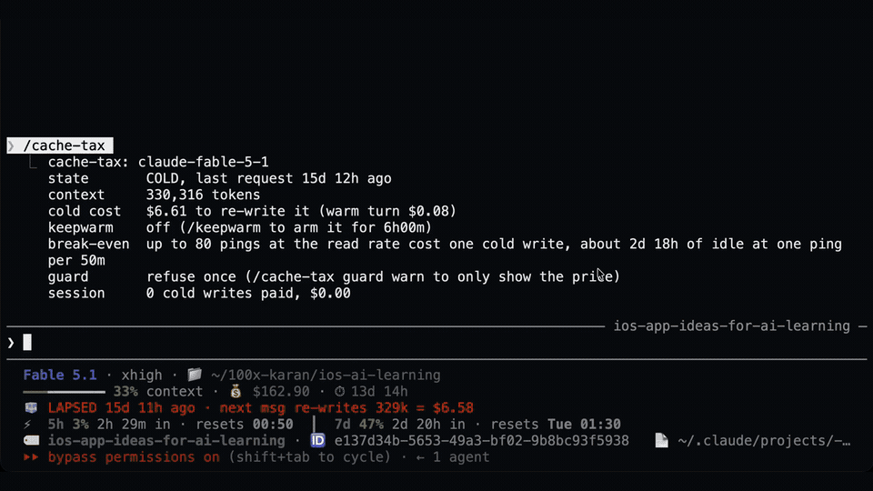

<picture>
  <source media="(prefers-color-scheme: dark)" srcset="site/assets/cache-tax-dark.svg">
  
</picture>

# Claude Code용 Cache Tax

> 한국어판은 claude-code-mods-ko 프로젝트가 번역했습니다. 원작자와 라이선스는 문서 끝에 있으며, 영어 원문은 [README.en.md](README.en.md)에서 볼 수 있습니다.

**쉬는 동안 Claude Code의 프롬프트 캐시를 따뜻하게 유지합니다.**

Cache Tax는 자리를 비운 사이 프롬프트 캐시를 갱신해 주고, 콜드 전송 전 예상 재작성 비용을 보여 주는 Claude Code 모드입니다. 쉬기 전에 `/keepwarm 90m`을 실행하세요. 핑은 토큰을 소모하므로 돌아올 것으로 예상되는 시간 창을 고르세요.

**[설치](#install)** · [웹사이트](https://cachetax.aidojo.si/) · [동작 방식](#how-it-works) · [비용과 플랜 한도](#cost-and-the-plan-limit-question) · [명령](#commands)



330k 토큰 세션에서 두 줄 요약을 요청했을 때 **6.61달러 예상가**가 나왔고, 재전송 후 보고된 캐시 쓰기는 **6.28달러**였습니다. 2.1.1에서 녹화했으며 현재 문구는 예상 토큰 수 \"까지\"입니다. 구독 추가 요금이 아닌 API 환산 비용입니다.

## 설치

[Claude Code 2.1.287 이상](https://code.claude.com/docs/en/plugins/mods/overview#turn-mods-on-or-off), 1시간 캐시, Claude Code 실행 상태가 필요합니다. 모드는 기본적으로 켜져 있습니다. 핑에는 출력 토큰도 포함되어 비용이 듭니다.

```sh
claude plugin marketplace add karanb192/claude-code-mods
claude plugin install cache-tax@claude-code-mods
```

Claude Code를 재시작하거나 열린 세션에서 `/reload-plugins`를 실행하세요. 얼리액세스 플래그는 필요 없습니다. 예전에 `CLAUDE_CODE_ENABLE_FUNCTION_HOOKS`를 설정했다면 제거하세요. 현재 Claude Code는 그것을 무시합니다.

따뜻한 세션에서 `/keepwarm`은 6시간을 무장합니다. 더 짧게는 `/keepwarm 90m`, 중지하려면 `/keepwarm off`를 쓰세요.

**주 캐시 수명을 확인하세요.** 구독 사용량에는 기본 1시간이 포함됩니다. API 키·사용 크레딧·클라우드 제공자 세션은 기본 5분이므로 그 결제 경로에서는 [`promptCacheTtl`](https://code.claude.com/docs/en/prompt-caching#choose-the-ttl-yourself)을 `"1h"`로 설정하세요. 50분 타이머로는 5분 캐시를 보호할 수 없습니다. 증거는 [한계](#limits) 참고.

**설정 훅을 선호하나요?** [훅 버전](https://github.com/karanb192/claude-code-hooks/tree/main/plugins/cache-tax)은 기본 경고, `CACHE_TAX_BLOCK=1`로 한 번 거부, 독립 상태 줄 카운트다운을 제공합니다. 따뜻하게 유지하는 기능은 이 모드에 있습니다.

한국어 마켓플레이스에서는 다음 명령으로 설치합니다.

```
/plugin install cache-tax@claude-code-mods-ko
```

## 옵션

`/config`의 cache-tax 아래:

    Auto keepwarm:    on | off
    Display:          band | status
    Ping floor:       2 (a number, 0 or more)
    Headless prompts: guard | send

`on`(기본)은 오늘의 동작입니다. 콜드 캐시 쓰기를 지불한 뒤 keepwarm이 3시간 무장합니다. `off`는 `/keepwarm`으로 직접 무장할 때까지 기다리며, 거부 문구는 keepwarm이 꺼져 있다고 또는 무장한 창의 남은 시간을 알려 줍니다. `/keepwarm always`는 어느 쪽이든 무장합니다.

Ping floor는 예상 콜드 재작성 비용을 유휴 휴식 예산으로 나눕니다. 2는 예상 핑 지출이 재작성 비용의 절반 미만이도록 허용하고, 0은 제한을 끕니다. 핑 전에 이번 휴식에서 관측된 지출과 다음 핑 예상액의 합이 그 예산 미만이어야 합니다. 예상액은 최근 다섯 개의 따뜻한 영수증 중 최저가를 현재 모델·컨텍스트·프롬프트 등급으로 다시 계산합니다. 새 메인 턴은 지출을 초기화하지만 창 연장·중지 후 재무장은 초기화하지 않습니다. 건너뛴 핑은 캐시가 식도록 둡니다. 로그와 상태가 이유를 알려 주고 `$.cacheTax.status()`가 `pingSkipped`, `idlePingUsd`를 제공합니다.

첫 핑에는 영수증이 없어 그냥 발송됩니다. 이후 답변이 예상보다 비쌀 수 있으므로 보장 상한이 아닌 예상 기반 제한입니다. 가격·컨텍스트·가격 붙은 영수증이 없으면 비교할 수 없습니다. 영수증과 지출은 메모리에 있어 재시작·새 대화에서 사라집니다. 핑은 요청한 창보다 일찍 끝날 수 있습니다.

Display는 keepwarm 무장 중 상태를 어디에 표시할지 고릅니다. `band`(기본)는 프롬프트 위 줄로, 터미널에서는 텍스트 아이콘, 데스크톱에서는 큐브입니다. `status`는 같은 텍스트를 프롬프트 아래 상태 항목에 표시하고 줄을 그리지 않습니다. 다른 모드가 프롬프트 위를 차지할 때 쓰세요. 숨기는 설정은 없습니다. 핑은 토큰을 쓰므로 언제 실행되는지 항상 화면에 알려야 합니다.

## 동작 방식

**쉬기 전:** `/keepwarm`이 제한된 창을 무장합니다. 50분 유휴 후 Claude Code 안의 타이머가 세션 트랜스크립트를 포크해 도구 없는 요청 한 번을 보냅니다. 핑마다 사용량을 읽고, 읽기가 0이거나 쓰기가 읽기의 10%에 도달하면 멈춥니다. 유휴 지출 제한으로 창이 끝나기 전에 핑을 건너뛸 수 있습니다. 백그라운드 트랜스크립트 폴링 루프는 없습니다.

**콜드 상태로 돌아오면:** 5만 토큰 이상 컨텍스트에서 1시간 시계가 콜드라고 판단하면 일반 메시지를 보내기 전에 묻습니다. 질문에 예상 재작성 비용과 따뜻하게 유지하는 안내가 나옵니다. **그래도 전송**은 그 메시지를 보내고, **전송하지 않음**은 버립니다. 대화상자가 닫히거나 호스트가 답할 수 없으면 한 번 거부한 뒤 재전송은 통과됩니다. 대화상자에 답할 수 있는 SDK 호스트는 그 선택을 유지합니다. `/cache-tax guard refuse 5`는 5달러 이상에서 묻고(가격 행 없는 모델 포함), 그보다 싼 전송은 가격을 기록하고 진행합니다.

`Headless prompts: send`는 비대화형 `sdk` 출처 프롬프트를 기본 가드 설정에서 즉시 전송하도록 선택합니다. Claude Code는 `claude -p`와 Agent SDK 턴에 같은 필드를 쓰므로 둘 다 포함되며, CLI와 SDK 호스트를 구분할 수 없습니다. 기본 `guard`는 계속 묻거나, 답할 사람이 없으면 한 번 거부합니다. 명시적 `/cache-tax guard refuse`(달러 하한 유무 무관)는 `send`에서도 적용되고, `/cache-tax guard default`가 그것을 지웁니다. 원격 사람 메시지(`composer`, `bridge`, `unclassified`, 채널 출처)는 비대화형 호스트에서도 가드를 유지합니다. 백그라운드 알림과 예약 프롬프트는 사람이 다시 보낼 수 없으므로 가격을 기록해 전송됩니다.

헤드리스 거부는 이유를 반환하고 트랜스크립트·디버그 로그에 기록합니다. 스크립트 진단에는 Claude Code의 `--debug-file`을 쓰세요. 모드 API는 프로세스 종료 코드를 설정하거나 거부를 stderr에 쓸 수 없습니다. 거부가 반드시 0이 아닌 종료나 stdout의 이유를 내는 것은 아닙니다. 달러 하한에 걸린 옵트인 실행도 직접 재시도해야 합니다.

기본적으로 감지된 콜드 쓰기는 자동으로 최소 3시간 keepwarm을 무장하고 비용을 출력합니다. `always`가 켜져 있으면 기본 6시간(다른 값 지정 가능)입니다. Auto keepwarm [옵션](#options)이 자동 부분을 끕니다. `/cache-tax`는 현재 캐시 예상가, 워밍 창, 이 세션의 콜드 쓰기 집계를 보여 줍니다.

집계는 캐시 영수증을 따릅니다. 각 요청에서 다시 기록된 오래된 컨텍스트를 보고된 쓰기와 이전 컨텍스트에서 보고된 읽기를 뺀 값 중 작은 것으로 추정합니다. 읽기의 10% 미만인 누락분은 캐시 적중으로 봅니다. 적중 시 새 내용은 집계하거나 keepwarm을 무장하지 않지만, 상당한 부분 재작성은 그럴 수 있습니다. 각 재작성은 그 요청의 모델과 가격 등급을 씁니다.

호스트가 턴 사용량 합계만 보고하면 이후 캐시 읽기에 숨은 재작성을 놓칠 수 있고, 압축된 턴은 요청별 영수증 없이 점수가 없습니다.

가드가 허용한 전송에서 재작성이 감지되지 않으면 자동 콜드 쓰기 창이 열리지 않았거나 기존 워밍 상태를 이름으로 알려 주는 완료 메모가 나옵니다. 합계 사용량으로 서버 캐시 상태를 확인한 것은 아닙니다. `/clear`로 중단된 콜드 쓰기 완료는 새 대화에서 자동 창을 열 수 없습니다.

압축 준비나 건너뛰기는 워밍에 영향을 주지 않습니다. 적용된 압축은 새 접두사를 읽거나 쓰는 메인 요청까지 워밍을 일시정지합니다. 그 후 턴이 도구나 사용자 답변을 기다리는 동안 무장한 창이 다시 핑할 수 있습니다. 요약 쓰기는 집계에 넣지 않고, 압축 전에 지불한 재작성은 원래 컨텍스트와 가격을 유지합니다.

창은 개별 세션 소속입니다. 이미 콜드인 세션은 다음 턴을 기다린 뒤 핑하고, Claude Code 재시작 후 복원된 창도 새 프로세스가 포크할 턴이 있을 때까지 기다립니다. 포크할 것이 없으면 한 줄 알림이 한 번 나오고 다음 메시지 후 핑이 시작됩니다. 바쁜 API(429, 529, 5xx)가 거부한 핑은 캐시가 식기 전에 도착할 수 있다면 1분, 2분, 4분 후 재시도합니다. `always`가 켜지면 캐시에 닿는 각 턴이 기본 주기에서 기본 always 창(6시간) 이상을 유지하며, 유휴 지출 제한과 성공적인 웜 읽백이 적용됩니다. `/keepwarm always 24h`는 모든 세션에서 그 하한을 24시간으로 바꿉니다(1~168시간, 인자 없는 `/keepwarm always`는 6시간으로 복귀). 같은 턴이 멈춘 창을 되살리고, 짧은 창을 always 창으로 늘리고, 테스트 주기를 초기화합니다. 사용자가 지정한 더 긴 창은 유지됩니다. 어느 세션에서든 `/keepwarm off`는 다음 턴부터 모든 세션의 롤링을 멈춥니다. 창은 기한에 끝나고, `/keepwarm off`는 취소하고 always 설정도 지웁니다.

### 기록된 워밍 핑


Sonnet 5, 2026년 9월 16일: 상태에 **75k 토큰 읽음, 0.02달러**가 보고되었습니다. 실제 실행 중 대화에는 아무것도 표시되지 않았습니다. 이 캡처는 2.0.0의 1분 테스트 간격을 썼고, 카드의 0.45달러 재작성 예상가는 오래된 Sonnet 가격 행(현재 행では 같은 컨텍스트가 0.30달러)을 썼습니다. 2센트 핑은 그 세션의 영수증이며 고정 가격이 아닙니다.

## 짧은 메시지가 이렇게 비쌀 수 있는 이유

캐시된 접두사가 만료되면 \"요약해 줘\" 같은 말도 답변 전에 오래된 컨텍스트를 다시 기록하게 합니다. Cache Tax의 Fable 5.1 가격 행은 1시간 쓰기 100만 토큰당 20달러, 캐시 읽기 0.25달러를 비교합니다. 토큰당 80배이며 총 절감액이 80배라는 뜻이 아닙니다. [가격 가정](#cost-and-the-plan-limit-question)과 [Anthropic 가격표](https://platform.claude.com/docs/en/about-claude/pricing) 참고.

[23초 개요 보기](docs/assets/cache-cost-explainer.mp4). 설계 장면에는 Fable 5.1 정가가 표시되고, 터미널·상태 줄 픽셀은 위의 실제 거부 녹화와 웜 영수증에서 나왔습니다. 거부는 2.1.1, 웜 크롭은 2.0.0에서 녹화했습니다.

캐싱이 처음이라면 [Claude Code의 캐시 사용법](https://code.claude.com/docs/en/prompt-caching)을 읽으세요.

## 명령

    /keepwarm               keep warm for six hours
    /keepwarm 90m           keep warm for a window of your own, 1m to 168h (also 2h30m, 6h)
    /keepwarm always        keep every session warm until six hours after its last turn, remembered across sessions
    /keepwarm always 24h    the same, until 24 hours after the last turn (1h to 168h)
    /keepwarm 6h every 2m   pinging every two minutes; a testing knob, 1m to 59m, forgotten after this window (with always on, at your next turn)
    /keepwarm status        the warming window, next ping and last receipt
    /keepwarm off           stop, forget the window, and turn always off
    /cache-tax              the card
    /cache-tax guard warn   show the price and send (the hook's default)
    /cache-tax guard default
                            restore the default guard and let Headless prompts control non-interactive SDK sends
    /cache-tax guard refuse ask before a cold send, overriding Headless prompts: send
    /cache-tax guard refuse 5
                            ask only at $5 or more; below that, show the price and send
    /cache-tax guard test   ask once on the next prompt you send as if the cache were cold, priced at this session's context; the test scores nothing, a send into a really cold cache is scored as usual

`/keepwarm`은 추가 단어, 잘못된 기간, 한계 밖의 창을 현재 워밍 창을 바꾸지 않고 거부합니다. 시작 시 잘못되거나 너무 긴 저장 기한도 버립니다. 첫 핑 전에 끝나는 창은 답변에서 그 사실을 알립니다.

질문 원문은 다음과 같고 아래에 **그래도 전송 ($4.01)** 과 **전송하지 않음**이 있습니다.

    cache-tax: the prompt cache went cold 2h00m ago. Sending this re-writes up to 200,502 tokens at $20/MTok = $4.01 (a warm turn would have cost $0.05). Don't send saves $4.01; after Send anyway, keepwarm is armed for up to 3h00m. The cache read alone is about $0.05 per ping. Pings may stop sooner at the idle spending limit, leaving the cache to go cold. Send it anyway?

질문이 닫히거나 가드된 헤드리스 실행에서 표시할 수 없으면 대신 거부가 나오고 재전송은 통과됩니다.

    cache-tax: the prompt cache went cold 2h00m ago. Sending this re-writes up to 200,502 tokens at $20/MTok = $4.01 (a warm turn would have cost $0.05). Send it again to pay it, and keepwarm will be armed for up to 3h00m, but may stop sooner at the idle spending limit. Or /clear and start from a note.

이 수치는 상한입니다. 재개된 세션에서 엔진이 보고하는 컨텍스트 수는 마지막 응답의 입력·캐시 읽기·캐시 쓰기·출력을 합한 것이고, 재개 페이로드에는 뺄 별도의 출력 수가 없습니다. 15일 된 세션 한 곳에서 가드는 330,316토큰과 6.61달러를 말했고 뒤이은 쓰기는 314k 토큰, 6.28달러였습니다.

keepwarm이 무장된 동안 터미널과 데스크톱 Code 탭은 Display가 `status`가 아닌 한 프롬프트 위 줄을 표시합니다. 터미널은 상태 색의 굵은 `[>]` 텍스트 아이콘, 데스크톱은 Cache Tax 큐브(따뜻하면 초록 뚜껑, 콜드면 주황, 첫 턴 전이나 압축 후는 회색)입니다. 굵은 상태 레이블도 일치하고 타이머·영수증 텍스트는 보통 굵기입니다. 비어 있지 않은 `NO_COLOR`는 두 표면에서 굵은 텍스트 아이콘을 선택하고 상태 색을 제거합니다. 두 표시 모두 `warm`, `cold`, `unknown`을 말하므로 색이 유일한 신호는 아닙니다. 이 상태는 `/cache-tax`와 같은 1시간 시계에 기반한 추정치이며 실시간 서버 캐시 확인이 아닙니다.

줄과 일반 상태 대체는 keepwarm 무장 중 유휴 상태를 포함해 1분마다 새로고침됩니다. 새로고침은 표시만 갱신하고 모델 요청을 보내지 않습니다.

줄에는 워밍 창, 다음 핑, 마지막 읽백이 있습니다. 멈춘 루프는 중립 기호와 이유를 표시합니다. `/keepwarm off`나 만료된 창은 줄을 제거합니다. 설문이 잠시 우선하며 다른 모드의 내용은 띠에 남습니다. Display `status`는 같은 레이블 텍스트를 상태 항목에 표시하고, 띠가 없는 표면은 Display가 `band`일 때 일반 상태 텍스트를 유지합니다.

데스크톱 큐브와 터미널의 콜드 색은 Claude의 밝은·어두운 테마를 따릅니다. 내장 SVG는 웹사이트 공식 자산이며 유지 보수자는 `python3 tools/generate-status-icons.py`로 다시 생성할 수 있습니다. 런타임에 이미지 파일을 읽거나 가져오지 않습니다.

모드는 세션 시작 시 테마와 `NO_COLOR`를 한 번 읽습니다. 허용된 테마 변경은 아이콘을 즉시 갱신하지만 일반 다시 그리기는 두 설정을 다시 읽지 않습니다. `NO_COLOR`는 세션 시작 전에 설정하세요.

## 두 가지 형태가 모두 설치된 경우

훅과 모드는 이름과 역할이 같아 둘 다 있으면 콜드 전송마다 가드가 두 개입니다. 모드는 세션 시작 시 훅의 `/cache-tax:status` 명령이 있는지 확인하고 한 번 알립니다. 가드는 하나만 유지하세요. 설정 훅을 선호하는 사람은 훅을 선택지로 남겨 둘 수 있습니다. 제거 전에 상태 줄을 확인하세요. `cache-tax.js`에 연결된 🧊 줄은 훅의 파일에서 나옵니다. 이 모드는 keepwarm 무장 중 프롬프트 위에 그리며 셸 상태 줄을 대체하지 않습니다.

## 접근할 수 있는 것

Claude Code 2.1.312에서 검증:

    ❯ ./register.ts hooks: config.set{key=theme}, ui.render{component=AbovePrompt}, session.start, session.end, classic.SessionStart, command.run{command=keepwarm}, command.run{command=cache-tax}, prompt.submit, turn.step, turn.complete, session.compact
    ❯ ./register.ts calls: $.clock.after (via arm, ping), $.clock.every (via updateStatus), $.clock.now, $.command.list, $.command.register, $.config.list, $.env.get, $.model.fork (via ping), $.session.id (via reseat, seat), $.session.model, $.session.usage, $.store.delete, $.store.get, $.store.set, $.ui.ask (via ask), $.ui.invalidate, $.ui.log, $.ui.resolve, $.ui.status
    ❯ ./register.ts env reads: NO_COLOR

 reach 수준 L2, Claude를 운전합니다. 사용자가 입력하는 모든 프롬프트, 각 모델 요청의 시점, 각 답변의 토큰 수를 봅니다.

같은 스캔이 [Awesome Claude Code Mods의 cache-tax 페이지](https://mods.aidojo.si/mods/karanb192--cache-tax--cache-tax/)에 있으며 수천 개 모드의 접근 범위가 기록되어 있습니다.

    cache-tax 위협 모델 (reach L2, Claude를 운전)
    1. 읽기: 각 프롬프트가 슬래시로 시작하면서 다른 텍스트가 없는지(텍스트는 그대로 전달, 보관·기록 안 함), 시각, 엔진이 이미 가진 turn.complete 및 포크 응답의 토큰 수와 모델 id, Claude Code가 설정 훅용으로 계산하는 재개 필드, 명령 목록, 세션 id·모델·엔진의 컨텍스트 수·시작 시각(프로세스가 실행하는 대화마다 한 번), 콜드 전송 가격 산정 전과 각 핑 전의 모델 다시 읽기, /clear나 인프로세스 재개로 끝나는 대화의 이유와 세션 id, 각 메인 요청의 메시지 수, 자체 $.store의 세션별 keepwarm 기한·핑 주기·전역 always 스위치(및 창)·가드 모드와 달러 하한, 로드 시 Auto keepwarm·Display·Ping floor·Headless prompts 옵션, 세션이 대화형으로 시작되었는지
    2. 실행: keepwarm 창 안의 유휴 구간마다 한 번, 핑 주기마다 한 번 $.model.fork. 창 밖에는 없고, 이미 콜드인 캐시에는 없고, 읽백이 아무것도 읽지 않았거나 읽기의 10분의 1 이상을 썼다면 다시 없으며, 가격과 영수증을 알 때 관측된 유휴 지출과 다음 핑 예상액이 재작성 비용을 Ping floor로 나눈 값 미만일 때만(0은 제한 해제). 콜드 전송 전 Claude Code 자체 대화상자의 질문 한 번, 또는 /cache-tax guard test 다음 프롬프트에서 한 번
    3. 전송: 포크, 즉 세션 트랜스크립트를 고정 한 줄 프롬프트로 보내는 API 요청 외에는 컴퓨터 밖으로 나가는 것 없음
    4. 유지: $.store에 이 세션 id 아래 keepwarm 기한과 핑 주기(always 켜지면 매 턴마다 다시 씀), 모든 세션의 always 스위치(참 또는 밀리초 단위 창)와 가드 모드(달러 하한이 그 자리에 저장). 거부 후에는 재전송이 새 프로세스(claude -p는 턴마다 새 프로세스)에서 통과되도록 이 세션 id 아래 마지막 응답 시각을 저장하고 재전송·/clear가 삭제. 끝난 창은 종료 시와 이 세션의 다음 시작 시 삭제되고 2.1.0 저장소의 알못 키도 정리. 다른 세션의 키는 여기서 삭제하지 않음. 읽고 삭제는 그 세션의 창 갱신에 대해 원자적으로 만들 수 없음. keepwarm을 무장하고 돌아오지 않은 세션은 작은 키 두 개를 남김. 세션의 콜드 쓰기 집계, 최근 다섯 개의 웜 핑 영수증, 유휴 핑 지출은 메모리에만 있고 프로세스와 함께 사라짐
    5. 적대 입력: 파싱하는 텍스트는 두 명령의 인자뿐이며 기간 정규식, 달러 금액, 몇 개 리터럴과 대조. 대화상자 답변은 자체 레이블 두 개와만 비교. 프롬프트 텍스트는 슬래시 여부를 위해 첫 공백 아닌 문자만 검사. 도구 결과와 파일은 분기에 닿지 않음. 포크 프롬프트는 상수라 조작된 것을 보낼 수 없음. 가드는 사용자의 메시지만 버릴 수 있음. 전송하지 않음 이후 재전송에는 다시 묻고, 닫힌·답할 수 없는 질문 이후에는 무조건 통과. 훅이 예외를 던지면 엔진이 건너뛰고 메시지가 가드 없이 들어가며 흐린 줄 한 개가 남음

## 비용과 플랜 한도 질문

가격은 정가 표입니다. Fable 5.1은 100만 토큰당 읽기 0.25달러, 1시간 쓰기 20달러, 답변 50달러이고, Fable 5.2(0.20, 16, 40), Sonnet 5(0.20, 4, 10)도 각 행이 있습니다. 표에 있는 버전만 가격이 붙고, 표보다 새 모델은 달러에 `n/a`와 가격 행 없음 안내 한 줄이 나오며 오래된 모델 요금을 빌리지 않습니다. API 키에서는 계산이 단순합니다. 핑은 캐시 읽기, 자체 비캐시 토큰 몇 개(기본 요율), 모델이 답한 것(출력 요율)을 청구하며 표시된 핑 비용은 모두 합산합니다. 포크에는 출력 상한이 없고 모델이 \"따뜻함\"이라고 말하기 전에 생각할 수 있기 때문입니다. 만료 후 돌아오는 것은 쓰기입니다. 카드는 모델의 읽기 전용 상한, Fable 5.1에서는 80회 핑, 현재 핑 주기로 덮이는 유휴 시간을 출력합니다. 실제 핑은 읽기보다 조금 비싸므로 진짜 손익분기점은 그보다 낮습니다. 구독에서는 달러는 척도일 뿐 청구서가 아니며, 캐시 읽기가 5시간·주간 한도에 어떻게 반영되는지 문서로 찾을 수 없었습니다. 첫 창에서 상태 줄의 사용량 한도 행을 지켜보세요.

## 한계

- 모드는 Claude Code 2.1.287+ 필요. 기본 켜져 있지만 로컬 설정, 안전 모드, 조직 정책이 로드를 막을 수 있습니다. [모드 제어](https://code.claude.com/docs/en/plugins/mods/overview#turn-mods-on-or-off) 참고.
- 50분 일정은 1시간 주 캐시가 필요합니다. 구독 사용량에는 기본 포함이고, 다른 결제 경로는 [`promptCacheTtl`](https://code.claude.com/docs/en/prompt-caching#choose-the-ttl-yourself)을 `"1h"`로 설정해야 합니다.
- 기본 간격으로 트랜스크립트 확인한 복귀 한 번(2026년 9월 19일, 구독 Fable 5.1): 휴식 42분에 `/keepwarm` 무장, 50분에 핑이 157k를 읽었고, 62분에 보낸 메시지는 캐시에서 156,886토큰을 읽고 2,255를 썼습니다. Claude Code 자체 캐시 카운트다운은 핑 후 58분으로 초기화되어 포크가 1시간 TTL을 이어갔습니다. 한 실행·한 설정의 관측이며, 모든 구성의 순절감을 증명하지는 않습니다. Claude Code는 포크를 메인이 아닌 요청 버킷(보통 5분)에 문서화합니다. 이 실행에서 포크는 1시간 세션 접두사를 읽고 네이티브 카운트다운을 초기화했습니다. 한 구성의 관측이며 모든 제공자가 버킷을 같게 처리한다는 증거는 아닙니다.
- 따뜻한 읽기가 나온 핑은 그때 캐시가 따뜻했다는 증거입니다. 접두사 변경은 시간과 무관하게 캐시를 무효화할 수 있고 정확한 효과는 모델과 Claude Code가 변경을 적용하는 시점에 달려 있습니다. [캐시 동작](https://code.claude.com/docs/en/prompt-caching) 참고.
- 재개 필드가 있으면 가드가 재개 후 첫 일반 전송을 확인합니다. 없으면 첫 턴이 시계와 컨텍스트를 씁니다.
- Team·Enterprise 계정에서는 위에 놓인 관리형 플러그인이 클래식 이벤트와 압축을 처리하고 아래로 전달하지 않으므로 모드에 닿지 않습니다. 그래서 `/clear`는 세션 종료로 알고 keepwarm이 멈추고 새 대화가 자체 창을 얻으며, 재개 트랜스크립트는 엔진 수치에서 컨텍스트를 얻지만 마지막 응답 시각이 없어 트랜스크립트 첫 실행 후 1시간이 지난 뒤 첫 메시지는 거부 대신 콜드 전송 비용을 기록하고, 압축은 이전 요청 메시지 수의 절반 미만인 요청으로 감지합니다(되감기는 몇 개를 줄이고 요약은 수십 개를 대체). 압축과 그 요청 사이의 핑·전송은 여전히 오래된 컨텍스트를 봅니다. 압축 후 기록된 요약은 콜드 쓰기로 점수가 없고, 같은 턴에서 압축 전에 지불한 콜드 쓰기는 요청별 사용량을 보고할 때 점수를 받습니다. 인프로세스 재개를 거친 창은 새 세션의 키로 옮겨집니다.
- 가드의 토큰 수는 상한입니다. 엔진이 마지막 응답에 대해 보고하는 컨텍스트이며 재개 시 그 응답의 출력이 포함되고 뺄 별도 출력 수가 없습니다.
- 콜드 쓰기 집계는 세션별 메모리이며 `/clear`가 비웁니다.
- 컨텍스트 크기는 엔진의 실시간 창 수치입니다. 턴 자체 사용량은 응답들의 합이어서 10단계 턴에서는 컨텍스트를 10번 읽으므로, 호스트가 실시간 수치를 보고하지 않을 때만 대체입니다.

## 로컬 개발

로컬 체크아웃에서 한 세션 동안 로드:

    claude --plugin-dir .

설치 상태로 유지하려면 [마켓플레이스 명령](#install)을 쓰세요.

변경을 보내나요? [CONTRIBUTING.md](CONTRIBUTING.md)에 PR에 필요한 증거가 나와 있습니다.

## 내 세션에서 증명하기

목 시계 테스트는 타이머·가드·점수 산정을 증명할 뿐 포크가 주 캐시에 닿는것을 증명하지 않습니다. 그것은 핑 한 번으로 증명되며 캐시 읽기와 답변 비용이 듭니다. 따뜻한 세션에서:

    > Reply with one word: ready
    > /keepwarm 1h every 1m

1분 후 프롬프트 위 줄을 보거나, Display가 `status`이거나 띠가 없는 표면에서는 상태 항목을 보세요. `last ping read 20k $0.01`은 포크의 읽백입니다. `keepwarm stopped: the ping read ... and wrote ...`는 읽백이 웜 기준에 미달해 루프가 멈췄다는 뜻입니다. `API busy, ping retry 1 of 3`는 429, 529, 5xx 재시도이며, 세 번 후에도 바쁘거나 캐시가 식기 1분 전이면 멈춥니다. `nothing to fork yet`은 재시작 후처럼 포크할 대화가 없다는 뜻으로, 창이 다음 메시지를 기다립니다. 그 밖의 API 오류·중단·빈 응답은 이유와 함께 루프를 멈춥니다. null을 반환하는 오래된 엔진은 콜드 스냅샷·API 실패 합산 메시지를 표시합니다. `/keepwarm off`로 마무리하세요. 이 짧은 확인은 캐시 읽기만 증명하며 기본 50분 간격의 유지를 증명하지 않습니다.

## 테스트와 타입 검사

저장소 루트에서 실행:

```sh
claude plugin validate .claude-plugin/plugin.json
claude plugin test .
```

[366개 테스트](tests/register.test.ts)는 목 시계·엔진을 사용하며 다음을 다룹니다.

- **Auto keepwarm 옵션:** off는 지불한 콜드 쓰기를 점수로 남기고 keepwarm을 무장하지 않으며 거부·질문에서 그렇게 말함. 수동 무장 창은 기한까지 약속되고 계속 핑. always는 여전히 6시간 갱신.
- **Ping floor 옵션:** 누적 지출이 긴 휴식을 멈추고, 새 메인 턴이 초기화하며, 재무장은 초기화하지 않고, 최근 저가 영수증이 비싼 이상값을 이기고, 모델 전환 시 다음 핑 전에 가격을 매기며, 모델 읽기 중 off 명령이 그 핑을 취소. 중지에 걸린 핑은 비용에 포함되고 턴 후 끝난 것은 포함되지 않으며, 오류 난 턴은 건너뛰기를 유지. 기존 건너뛰기·압축·clear·알 수 없는 컨텍스트·제한 해제 범위도 유지.
- **Headless prompts 옵션:** 비대화형 SDK 프롬프트 옵트인, SDK 대화상자 답변, 대화형 SDK·원격 사람 가드, 명시적 거부와 달러 하한, 기본으로 재설정, 저장된 기본값 로딩 중 도착한 프롬프트.
- **가드:** 그래도 전송/전송하지 않음 질문, 닫힌 대체와 가드 테스트, 한 번 거부 후 재전송(새 프로세스·응답 없는 API 오류 포함), 경고 모드, 달러 하한(미만·이상·가격 없는 모델·마지막 턴 후 바뀐 모델), 슬래시 명령, 작은 컨텍스트, 사람이 입력하지 않은 프롬프트, 재개 시드, 콜드 쓰기 점수.
- **워밍:** 명령 기본값·거부된 창과 주기, always/off, 자체 창이 있는 always와 거부하는 창, `/clear` 후 always, 마지막 턴부터 롤링하는 always, 유휴 초기화, 사용량 기반 중지, 콜드 창 만료, 수면 후 지연 타이머.
- **세션 상태:** 격리된 저장소 키, 복원된 창, 레거시 정리, clear/압축 초기화, 서브에이전트 격리. 자동 창의 시계·저장소 대기 중 clear는 다음 대화를 무장하거나 수동 창을 지울 수 없음.
- **압축 준비:** 요약 준비·건너뛰기는 워밍을 그대로 둠. 적용 후 새 접두사를 읽거나 쓰는 메인 응답이 도구·사용자 대기를 하는 동안 워밍 재개. 요약 쓰기는 집계 밖, 실패 요청과 clear·중지·더 새로운 압축 후의 오래된 응답은 핑을 다시 시작할 수 없음.
- **위에 놓인 관리형 플러그인:** 클래식·압축 이벤트가 사용자 계층 아래로 이어질 때의 `/clear`, 재개, 복원 창, 압축, 같은 이벤트가 두 번 또는 순서 없이 전달되어도 두 번째 창·경고·초기화가 없는지, 인프로세스 재개로 옮겨진 창과 모델 변경, 재개 후 콜드해진 트랜스크립트, 되감기와 압축 구분, 콜드 쓰기인 요약과 아닌 요약(가드된 전송이 첫 요청 전 압축, 한 턴에 두 압축), 이전 대화 종료가 클래식 재개와 겹치거나 더 오래 지속되는 경우, 호스트가 다음 대화 id를 보고하기 전의 `/keepwarm`.
- **가격·표시:** 표에 있는 모든 모델의 날짜·제공자·표시 이름 표기, 표에 없는 버전의 빌린 행 없음, 가격 행 없는 콜드 쓰기를 달러 합계와 따로 셈, Haiku 5.5 긴 프롬프트 등급의 요청별 가격, 긴 웜 턴의 요청 합이 컨텍스트 절반을 쓰는 것을 콜드 쓰기와 분리, 가드된 캐시 적중과 큰 붙여넣기 점수 없음, 부분 재작성과 새 내용 분리, 이후 읽기가 요청별 누락을 숨기지 못함, clear 중 보류된 요청·컨텍스트 읽기에서 오래된 영수증 버리기, Opus 4·4.1과 4.5 구분, 출력·비캐시 입력 비용, 컨텍스트 수, 지속 시간 형식, 읽기 전용 손익분기 수치.
- **표시기:** 이미지 요소 없는 터미널 텍스트 아이콘, 데스크톱 SVG, 테마 선택, 웜·콜드 전환, 재개, 압축, clear, 만료, 설문, 다른 모드의 내용, `NO_COLOR` 대체.
- **Display 옵션:** `band`는 줄을 그리고 `status`는 cache-tax·상태 레이블을 포함한 텍스트를 터미널·데스크톱의 상태 항목으로 옮기고 줄을 그리지 않음. 그 밖의 값(오래된 `off` 포함)은 줄로 대체.
- **기본값:** 세션마다 한 번 읽기, 즉각 테마 갱신, 거부된 변경, 설정 기록기가 반환하는 유효 테마.
- **포크 실패:** 캐시가 따뜻한 동안 바쁜 API 재시도, 너무 늦게 깨어난 재시도 버리기, 포크할 것 없으면 다음 턴 대기, 핑은 한 번에 하나, 요청·`/clear`·압축 후 도착한 응답 버리기, 그 밖의 실패와 오래된 릴리스의 null 결과는 재시도 없이 중지.

렌더 테스트는 요소 트리를 검사하며 네이티브 터미널·데스크톱 픽셀은 검사하지 않습니다. 서버 측 캐시 유지를 검증하지 않습니다. [실제 확인](#prove-it-on-your-own-session) 참고.

### 타입 검사

이 체크아웃을 `claude --plugin-dir .`로 로드해 플러그인 곁에 선언을 생성한 뒤 저장소 루트에서:

```sh
npx -p typescript tsc -p .
```

## 다른 Claude Code 모드

더 많은 모드는 [claude-code-mods-ko](https://github.com/claude-code-mods/claude-code-mods-ko) 마켓플레이스에서 찾을 수 있습니다.

## 출처 및 라이선스

- 원작자: [karanb192](https://github.com/karanb192/cache-tax)
- 원본 저장소: https://github.com/karanb192/cache-tax
- 라이선스: MIT
- 한국어 번역 및 UI 현지화: claude-code-mods-ko 프로젝트
