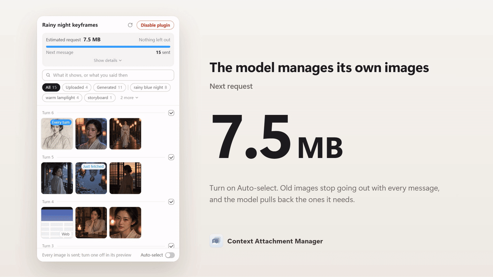
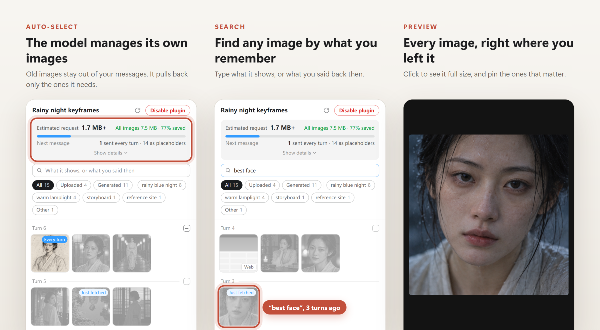

<p align="center">
  
</p>

<h1 align="center">Context Attachment Manager</h1>

> 한국어판은 claude-code-mods-ko 프로젝트가 번역했습니다. 원작자와 라이선스는 문서 끝에 있으며, 영어 원문은 [README.en.md](README.en.md)에서 볼 수 있습니다.

<p align="center"><b>Codex, Claude Code 및 기타 에이전트에서 이미지가 많은 대화를 위한 로컬 플러그인.</b><br>이전 이미지가 모든 메시지와 함께 다시 전송되지 않습니다. 모델이 ID로 필요한 이미지를 가져오며, 대화가 압축된 후에도 가능합니다.</p>

<p align="center">
  <a href="https://github.com/chipfighter/context-attachment-manager/releases"></a>
  
  <a href="LICENSE"></a>
</p>

<p align="center"><b>English</b> · <a href="README_CN.md">简体中文</a> · <a href="README_JA.md">日本語</a> · <a href="README_KO.md">한국어</a> · <a href="README_ES.md">Español</a> · <a href="README_PT_BR.md">Português (Brasil)</a> · <a href="README_FR.md">Français</a> · <a href="README_DE.md">Deutsch</a></p>

<p align="center">
  
</p>

## 동작 방식

에이전트는 보통 메시지마다 이전 이미지를 모두 다시 보내므로, 이미지가 많은 긴 대화는 느려지고 전송이 막힐 수 있습니다. 이 플러그인은 각 이미지에 번호(`IMG-001`, `IMG-002`, …)를 매기고 이전 이미지는 짧은 자리표시자로 보냅니다.

- **모델이 필요한 것을 가져옵니다**: 이전 이미지를 다시 봐야 할 때 ID로 원본을 되돌려 받습니다.
- **이미지를 구분할 수 있습니다**: 모델이 각 이미지의 내용에 대한 한 줄과 사용자의 코멘트를 기록합니다. 대화가 압축된 뒤에도 자리표시자에 남습니다.
- **캐시가 계속 동작합니다**: 자리표시자는 한 번 기록된 뒤 변하지 않으므로 이전 대화를 모델의 프롬프트 캐시에서 읽을 수 있습니다. [캐시가 동작하도록 하는 설계](#design-keep-the-cache-working) 참고.
- **아무것도 삭제되지 않습니다**: 원본 이미지와 대화 기록은 그대로 남습니다.

기본값으로 켜져 있으며 패널을 열 필요가 없습니다. 대표 사용 사례는 이미지·비디오 제작, 스캔 문서, 컴퓨터 및 브라우저 조작입니다.

## 설치

다음 문장을 에이전트에 보내세요. 플랫폼을 파악하고 알맞은 설정을 설치합니다.

```text
Install Context Attachment Manager for me, following https://github.com/chipfighter/context-attachment-manager/blob/main/INSTALL.md
```

그다음 에이전트를 재시작합니다(Claude Desktop에서는 새 Code 세션을 시작). [지원 에이전트](#works-with)와 [설치, 업데이트, 제거](INSTALL.md)를 참고하세요.

한국어 마켓플레이스에서는 다음 명령으로 설치합니다.

```
/plugin install codex-attachment-manager@claude-code-mods-ko
```

## 직접 제어할 때 쓰는 패널

<p align="center">
  
</p>

- **이미지 찾기**: 기억하는 세부 사항이나 코멘트("비 오는 밤", "가장 좋은 얼굴" 등)로 검색합니다.
- **참조를 화면에 유지**: 이미지를 열고 **Send every turn**을 확인합니다.
- **직접 이미지 선택**: **Auto-select**를 끄고 다음 메시지에 포함할 이미지를 고릅니다.

**Codex**에서는 작업의 사이드 패널에서 **Context Assets**를 엽니다. **Claude Desktop의 Code 탭**에서는 이미지가 있으면 패널이 자동으로 열리며, `/cam`을 입력해 다시 불러올 수 있습니다.

## 프라이버시

플러그인은 로컬에서 실행됩니다. 원본 이미지와 대화 기록은 컴퓨터에 남고, 요청은 에이전트가 이미 사용하는 서비스로 전송됩니다.

## 테스트 방법

Codex에서 9개의 키프레임이 있는 대화는 42.4MB까지 커져 재시작이나 압축 후 전송할 수 없었지만, 플러그인을 사용하면 같은 요청이 0.12MB였습니다. 결과와 재현 절차는 [Codex 비교](eval/README.md)와 [Claude Code 장기 작업 비교](eval/long-task/README.md)를 참고하세요.

## 설계: 캐시가 동작하도록 하기

모델 서비스는 대화의 앞부분을 캐시합니다. 요청이 이전 요청과 정확히 같은 시작 부분을 가지면 그 부분을 캐시에서 읽어 더 빠르고 훨씬 저렴하게 처리합니다. 대화 초반에 무언가 바뀌면 그 뒤의 모든 것을 다시 처리합니다.

긴 대화를 작게 만드는 모든 방법은 무언가를 바꿔야 합니다. 이 플러그인은 가능한 한 대화의 뒤쪽에서 변경을 가합니다.

<p align="center">
  
</p>

- **자리표시자는 한 번 기록됩니다**: 이미지가 나타난 다음 턴에서 자리표시자가 되므로 그 턴의 나머지만 다시 처리됩니다. 이후 자리표시자는 요청마다 동일하게 유지됩니다.
- **가져오기는 앞부분을 바꾸지 않습니다**: 원본은 현재 턴의 끝에 추가되고 자리표시자는 제자리에 남습니다. 어떤 이미지를 선택하든 대화에 몇 개가 있든 현재 턴 이전은 캐시에서 읽힙니다.
- **모델은 원본을 되돌려 받습니다**: 축소한 사본이나 요약이 아닙니다.

<p align="center">
  
</p>

이것이 완전히 공짜는 아닙니다. 이미지가 있는 턴 이후 그 턴의 나머지가 한 번 다시 처리되고, 모델이 새 이미지마다 짧은 줄을 기록합니다. 패널에서 오래된 이미지를 변경(선택 해제, 다시 선택, **Send every turn**)하면 그 이미지 지점에서 대화가 바뀌므로 뒤따르는 내용이 한 번 다시 처리됩니다. [Claude Code 장기 작업 비교](eval/long-task/README.md)에서 플러그인을 사용했을 때 입력의 87%가 캐시에서 읽혔고, 사용하지 않았을 때는 91%였습니다.

첫 번째 그림의 세 번째 행은 에이전트 자체 압축과 API 측에서 오래된 도구 결과를 지우는 것(예: Anthropic의 context editing)과 같습니다. 초반 내용이 제거되고 뒤따르는 내용이 다시 처리됩니다.

## 지원 에이전트

Codex와 Claude Code는 테스트했으며, Codex와 Claude Desktop에는 패널도 있습니다. 아래 다른 에이전트는 코드와 문서를 바탕으로 작성된 어댑터로 지원하지만 아직 실제로 테스트하지는 않았습니다. 사용하신다면 성공 여부와 상관없이 [결과를 알려 주세요](https://github.com/chipfighter/context-attachment-manager/issues).

| 에이전트 | 설명 | 지원 상태 |
|---|---|---|
| [Codex](https://github.com/openai/codex) | OpenAI의 코딩 에이전트, 데스크톱 및 CLI | 자동 선택 + 패널, 테스트됨 |
| [Claude Code](https://github.com/anthropics/claude-code) | Anthropic의 코딩 에이전트, 데스크톱 및 CLI | 자동 선택 + 패널(데스크톱), 테스트됨 |
| [WorkBuddy](https://www.workbuddy.cn) | CodeBuddy를 내장한 텐센트의 데스크톱 AI 업무 도우미 | 자동 선택, 미테스트 |
| [OpenCode](https://github.com/anomalyco/opencode) | 모든 모델 공급자를 위한 오픈소스 터미널 코딩 에이전트 | 자동 선택, 미테스트 |
| [Gemini CLI](https://github.com/google-gemini/gemini-cli) | 구글의 오픈소스 터미널 에이전트 | 자동 선택, 미테스트 |
| [pi](https://github.com/earendil-works/pi) | 최소한의 확장 가능한 터미널 코딩 에이전트 | 자동 선택(pi 확장), 미테스트 |
| [DeepSeek Harness](https://github.com/deepseek-ai/deepseek-harness) | 모든 것이 플러그인인 DeepSeek의 에이전트 하네스 | 자동 선택(dsh 플러그인), 미테스트 |
| [Qwen Code](https://github.com/QwenLM/qwen-code) | Qwen의 오픈소스 터미널 에이전트 | 자동 선택, 미테스트 |
| [Cline](https://github.com/cline/cline) | VS Code, JetBrains, 터미널용 오픈소스 코딩 에이전트 | 자동 선택, 미테스트 |
| [Kilo Code](https://github.com/Kilo-Org/kilocode) | VS Code, JetBrains, 터미널용 오픈소스 코딩 에이전트 | 자동 선택, 미테스트 |
| [goose](https://github.com/aaif-goose/goose) | MCP로 확장하는 데스크톱·터미널용 오픈소스 에이전트 | 자동 선택, 미테스트 |
| [Cherry Studio](https://github.com/CherryHQ/cherry-studio) | 여러 모델을 위한 오픈소스 데스크톱 채팅 클라이언트 | 자동 선택, 미테스트 |

이 에이전트들의 설정: [INSTALL.md](INSTALL.md#other-agents). 다른 에이전트를 연결하려면 [ADAPTERS.md](ADAPTERS.md)를 참고하세요.

## FAQ

### Codex와 Claude Code는 왜 이미지가 많은 긴 대화에서 느려지나요?

에이전트가 메시지마다 이전 이미지를 모두 다시 보내므로, 이미지가 많은 긴 대화는 느려지고 전송이 막힐 수 있습니다. Codex에서 9개의 키프레임이 있는 대화는 42.4MB까지 커져 재시작이나 압축 후 전송할 수 없었지만, Context Attachment Manager를 사용하면 같은 요청이 0.12MB였습니다.

### Context Attachment Manager가 프롬프트 캐시를 깨뜨리나요?

조금만요. 자리표시자는 한 번 기록된 뒤 변하지 않고, 가져온 이미지는 현재 턴 끝에 추가되므로 이전 턴은 캐시에서 읽힙니다. 이미지가 있는 턴 이후 그 턴의 나머지는 한 번 다시 처리됩니다. Claude Code 장기 작업 비교에서 플러그인을 사용했을 때 입력의 87%가 캐시에서 읽혔고, 사용하지 않았을 때는 91%였습니다.

### 압축이나 이미지 축소와 어떻게 다른가요?

압축과 초기 기록 삭제는 대화의 앞부분을 제거하고, 이미지 축소는 내용을 바꿉니다. 어느 쪽이든 대화 거의 전체를 다시 처리하며 모델에는 요약이나 축소 사본이 남습니다. Context Attachment Manager를 쓰면 이전 턴의 나머지만 다시 처리되고 모델은 ID로 원본 이미지를 되돌려 받습니다.

### 모델이 여전히 이전 이미지를 볼 수 있나요?

네. 모든 이미지에는 `IMG-001` 같은 ID가 있고, 모델은 다시 봐야 할 때 원본을 가져옵니다. 대화가 압축된 후에도 가능합니다.

### 제 이미지가 삭제되거나 다른 곳으로 전송되나요?

아닙니다. 플러그인은 사용자의 컴퓨터에서 실행됩니다. 원본 이미지와 대화 기록은 그대로 남고, 요청은 에이전트가 이미 사용하는 서비스로 전송됩니다.

### 어떤 에이전트에서 동작하며 무료인가요?

Codex와 Claude Code는 테스트했습니다. WorkBuddy, OpenCode, Gemini CLI, pi, DeepSeek Harness, Qwen Code, Cline, Kilo Code, goose, Cherry Studio는 아직 실제 테스트하지 않은 어댑터로 지원합니다. MIT 라이선스의 무료 오픈소스입니다.

### Context Attachment Manager를 어떻게 설치하나요? 터미널이 필요한가요?

아닙니다. 위 [설치](#install)의 한 문장을 에이전트에 보내면 플랫폼을 파악해 직접 설정을 실행하고, 이후 에이전트만 재시작하면 됩니다(Claude Desktop에서는 새 Code 세션을 시작). Codex에서는 Plugins 페이지에서 몇 번의 클릭으로 설치할 수도 있습니다. 직접 설치하려면 Codex에서 명령 하나, Claude Desktop에서 `claude` 명령 두 개가 필요합니다. [INSTALL.md](INSTALL.md)를 참고하세요.

<p align="center"><sub><a href="CHANGELOG.md">변경 내역</a> · <a href="CONTRIBUTING.md">기여하기</a> · <a href="LICENSE">MIT 라이선스</a></sub></p>

## 출처 및 라이선스

- 원작자: [chipfighter](https://github.com/chipfighter/context-attachment-manager)
- 원본 저장소: https://github.com/chipfighter/context-attachment-manager
- 라이선스: MIT
- 한국어 번역 및 UI 현지화: claude-code-mods-ko 프로젝트
