> 한국어판은 claude-code-mods-ko 프로젝트가 번역했습니다. 원작자와 라이선스는 문서 끝에 있으며, 영어 원문은 [README.en.md](README.en.md)에서 볼 수 있습니다.

여러 AI 코딩 에이전트에 같은 질문을 병렬로 던지는 Claude Code 플러그인입니다. 한 모델의 편향이 오도할 수 있는 경우에 답변을 비교하세요. 아키텍처 결정, 디버깅 막다른 길, 보안 검토, 프레임워크 선택 등입니다.


[](https://github.com/hex/claude-council/actions/workflows/tests.yml)

## 실행 위치

| 위치 | 제공되는 것 |
| --- | --- |
| 터미널의 Claude Code | `/claude-council:ask`, 모든 자리(seat), 채팅 옆 패널 |
| Claude Desktop의 Code 탭 | 같은 플러그인과 같은 명령. 패널은 Desktop의 사이드 패널에 열림 |
| Claude Desktop의 일반 채팅 | [Desktop 확장](#claude-desktop): 다섯 도구, 자리 선택기, 채팅의 답변 패널. macOS 및 Linux |


두 경우 모두 Claude가 council을 도구로 호출할 수도 있습니다. 먼저 어떤 자리를 쓸지와 응답 길이를 묻고, Send 카드를 보여 주며, 사용자가 확인하기 전까지는 컴퓨터 밖으로 아무것도 나가지 않습니다.

claude.ai 채팅과 Cowork는 다른 제공자에 대한 호출을 차단할 수 있는 샌드박스에서 실행되므로 council이 동작하지 않습니다.

## 설치

macOS, Linux 또는 Git Bash를 통한 Windows에서 `curl`과 `jq`가 필요합니다.

```text
/plugin marketplace add hex/claude-marketplace
/plugin install claude-council
```

Claude Code를 시작하는 셸에서 제공자를 하나 이상 지정하세요.

```bash
export OPENAI_API_KEY="..."
# Or GEMINI_API_KEY, XAI_API_KEY, PERPLEXITY_API_KEY,
# KIMI_API_KEY, OPENROUTER_API_KEY
```

또는 플러그인 설정에 키를 저장할 수 있습니다. `/plugin configure claude-council`을 실행하고 API 키 행을 채운 뒤 Save configuration을 선택하세요. Claude Code가 설정 파일이 아닌 보안 저장소에 보관합니다. council 모드는 저장된 각 키를 세션 전체의 변수로 설정하므로 Claude Code가 모든 프로젝트에서 시작하는 모든 명령이 셸에서 내보낸 키 대신 저장된 값을 받습니다. OpenRouter 모델 행은 `OPENROUTER_MODELS`가 받는 모델 id를 사용하므로 라우터 자리도 내보내기가 필요 없습니다.

저장된 키에는 Claude Code 2.1.287 이상이 필요합니다. 데스크톱 앱의 플러그인 Settings 탭에서도 그 컴퓨터의 세션용으로 키를 받습니다. claude.ai 채팅이나 Cowork에는 절대 도달하지 않습니다. [API 키](docs/REFERENCE.md#api-keys)에 보관 위치, 모드가 로드되지 않는 경우, 키가 지워졌을 때의 동작이 나와 있습니다.

`codex`, `agy`(Antigravity), `grok`, `kimi`, `cursor-agent` CLI는 기존 구독을 사용하므로 API 키가 필요 없습니다. Claude Code 자체, Copilot CLI, OpenCode도 `--providers`에 이름을 지정하면 자리에 앉을 수 있습니다. 로컬 `ollama` 모델은 키나 외부 네트워크가 필요 없습니다. 이 중 아무것도 없다면 `--local`이 Claude 서브에이전트를 사용합니다. [공급자 선택](docs/REFERENCE.md#choosing-providers)과 [로컬 council](docs/USAGE.md#local-council---local)을 참고하세요.

한국어 마켓플레이스에서는 다음 명령으로 설치합니다.

```
/plugin install council@claude-code-mods-ko
```

## 60초 만에 첫 실행

코드에 관해 묻기 전에 [무엇이 전송되고 저장되는가](docs/REFERENCE.md#what-gets-sent-and-saved)를 읽으세요.

```text
/claude-council:status
/claude-council:ask "Should I use UUID or BIGINT primary keys for a SaaS users table?"
```

각 제공자가 독립적으로 답합니다. Claude가 동의, 불일치, 권장 사항을 종합해 씁니다. 동의가 검증은 아닙니다. 모델들이 여러분의 설명과 그 가정을 공유하기 때문입니다. [종합은 답을 바꿀 수 있는 전제를 짚어 준다](docs/REFERENCE.md#reading-the-synthesis).

## Claude Desktop

플러그인에는 Claude Code가 필요합니다.일반적인 Claude Desktop 채팅용으로 `council-<version>.mcpb` Desktop 확장이 있어 Claude에 다섯 도구를 제공합니다. `council_ask`, `council_pick`, `council_result`, `council_status`, `council_settings`입니다. council의 bash 스크립트를 시작하므로 macOS와 Linux에서만 실행됩니다.

1. [최신 릴리스](https://github.com/hex/claude-council/releases/latest)에서 `council-<version>.mcpb`를 다운로드하세요. 직접 빌드하려면 깨끗한 체크아웃에서 `bash extension/build.sh`를 실행하세요. `npm`이 필요하며 `dist/council-<version>.mcpb`를 기록합니다.
2. 파일을 더블클릭하세요. Desktop은 확장이 컴퓨터의 모든 것에 접근하고 Anthropic이 검증하지 않았다고 경고합니다. 파일에서 설치하는 모든 확장에 해당합니다. 서버가 사용자 권한으로 실행되어 파일과 네트워크에 접근하며 Anthropic이 검토하지 않았습니다. 직접 빌드하거나 신뢰하는 패키지만 설치하세요.
3. Settings, Extensions, Claude Council, Configure에서 원하는 각 제공자의 키를 붙여 넣으세요. Gemini, OpenAI, xAI, Perplexity, Kimi, OpenRouter입니다. 비워 두면 그 제공자의 API는 제외됩니다. Desktop이 키를 보관합니다. 질문에서 각 키는 자기 공급자의 자리에만 갑니다. 공급자의 API와 설치되어 있다면 그 CLI 에이전트(codex는 OpenAI 키, agy는 Gemini 키, grok은 xAI 키, kimi는 Kimi 키)입니다. 상태 확인은 다릅니다. 설치된 각 CLI 에이전트를 시작하되 `claude`와 `opencode`에는 모든 키를 설정한 상태로 실행합니다.
4. 채팅에서 Claude에 council 설정을 열라고 요청하세요. 채팅 패널에 각 키가 있는 제공자의 모델 목록이 그 제공자에서 실시간으로 가져와 표시됩니다. 제공자마다 하나를 고르거나 OpenRouter 모델 최대 12개를 켜면 각각 한 자리가 됩니다. 모든 변경은 즉시 저장되어 다음 질문부터 적용됩니다.
5. Claude에 질문을 council에 던지라고 하세요. Desktop이 도구 호출 승인을 요청하며, 질문이 컴퓨터를 떠나기 전의 유일한 검사입니다. 도구 호출 아래 패널에 각 자리의 답변이나 오류가 자리 이름과 공급자 로고가 있는 카드로 표시되고, Claude가 그 아래 종합을 씁니다. Desktop은 몇 초에서 몇 분까지 전체 실행을 기다립니다.

### 한 번에 질문하기

메시지에 자리 이름이나 응답 길이(standard, brief, detailed)를 적거나, 모두에게 물어 달라고 하면 Claude가 질문을 한 번에 실행합니다. 다른 자리를 지정하지 않았다면 기본 자리 모두에 standard로 갑니다. Claude는 질문을 사용자가 한 대로 전달하며, council이 볼 수 없는 이전 메시지에 의존할 때만 컨텍스트를 덧붙입니다.

### 선택기

그 밖의 경우, 예를 들어 "council에 물어봐: 어떤 큐를 써야 해?"라고 하면 Claude가 `council_pick`을 엽니다. 질문, 자리별 스위치, 세 가지 응답 길이가 있는 패널입니다. Claude는 같은 턴에서 `council_result`로 선택기의 실행을 기다립니다.

1. Ask를 누르면 답변이 그 패널에 표시되고 아래 줄에 "Claude is writing the synthesis"가 나옵니다.
2. Claude가 사용자의 추가 메시지 없이 종합을 씁니다. 모든 자리가 실패하면 무엇이 실패했는지 알려 줍니다.

어느 자리도 답하지 않으면 패널에그렇게 표시되고 Ask가 다시 동작합니다.

### 선택기에서 모델 바꾸기

API 자리나 OpenRouter 자리에서 회색 모델은 버튼입니다. 클릭하면 그 제공자의 실시간 목록에서 다른 모델을 고를 수 있습니다(OpenRouter에는 검색창이 있음). 선택은 설정 패널과 같이 즉시 저장되며 이번 질문과 이후 질문에 적용됩니다. OpenRouter 자리는 자기 모델만 바뀌며, OpenRouter 자리의 추가·제거는 설정 패널에서 합니다.

### Claude가 더 이상 기다리지 않을 때

Claude는 선택기가 열린 시점부터 최대 11.5분까지 기다립니다. 답변이 도착했을 때 이미 기다리지 않고 있거나 같은 패널에서 Ask를 두 번 누르면:

- Desktop이 악성 콘텐츠 주의 아래 메시지 상자에 "Synthesise the council's answers (run 3f9a2c)."를 넣고 답변 아래 줄에 Enter를 누르라고 안내합니다. 패널은 그 메시지를 직접 보낼 수 없습니다.
- Claude가 `council_result`로 그 실행의 답변을 가져와 종합을 씁니다.
- Desktop이 메시지를 거부하면 대신 직접 보낼 문구가 나옵니다(`Ask Claude: "synthesise council run 3f9a2c"`).
- 확장은 자리가 하나라도 답한 최근 5개 실행을 유지하며, 그 이후에는 다시 council에 물어야 합니다.

제공자를 지정하지 않은 질문은 키가 있는 모든 제공자와 스크립트가 찾는 모든 CLI 에이전트(`codex`, `agy`, `grok`, `kimi`, `cursor-agent`, `ollama`)에게 갑니다. PATH, `~/.local/bin`, `~/bin`, `/opt/homebrew/bin`, `/usr/local/bin`에 있는 것들입니다. `claude`, `copilot`, `opencode`는 질문에서 이름을 지정할 때만 받습니다. CLI 에이전트는 자체 로그인으로 답하므로 공급자의 키 칸이 비어 있어도 질문을 받습니다. 양식에서 자기 공급자 키 외의 키는 받지 않습니다. [참고 문서](docs/REFERENCE.md#claude-desktop-extension)에 보관 파일과 한계가 나와 있습니다.

## 기능

| 기능 | 안내 |
| --- | --- |
| 제공자들에게 함께 묻거나 평이한 말로 하나를 지정 | [명령 예시](docs/REFERENCE.md#command-examples) |
| 공급자 선택과 상시 명단 고정 | [공급자 선택](docs/REFERENCE.md#choosing-providers) |
| 전문가 역할 배정 | [역할](docs/USAGE.md#specialized-roles) |
| 제공자들이 서로의 답변에 도전하게 하기 | [토론](docs/USAGE.md#debate-mode) |
| 묻기 전에 에이전트로 코드 컨텍스트 모으기 | [에이전트 모드](docs/USAGE.md#agent-enhanced-analysis---agents) |
| 외부 제공자 없이 Claude 서브에이전트 사용 | [로컬 council](docs/USAGE.md#local-council---local) |
| 관련 파일 포함 또는 직접 선택 | [자동 컨텍스트](docs/USAGE.md#auto-context-injection) |
| 스크린샷 첨부 | [이미지 입력](docs/USAGE.md#image-input) |
| 현재 대화에 대해 묻기 | [`/advise`](docs/USAGE.md#asking-about-the-conversation-itself) |
| 백그라운드에서 실행 후 결과 가져오기 | [백그라운드 작업](docs/USAGE.md#background-jobs---async) |
| 답변을 파일로 내보내기 | [내보내기](docs/USAGE.md#export-to-file) |
| 종합만 표시 | [조용한 모드](docs/USAGE.md#quiet-mode) |
| 답변이 도착하는 것을 보고 실패한 자리 재시도 | [패널](#the-pane) |
| Claude가 작업하는 동안 한 자리의 알림 받기 | [알림 side-check](#heads-up-side-check) |
| Claude가 멈추기 전에 두 번째 모델이 diff 검토 | [Stop 게이트 검토](docs/USAGE.md#stop-gate-review-opt-in-off-by-default) |
| Claude Desktop 채팅에서 council에 묻기 | [Claude Desktop](#claude-desktop) |
| Claude Code 없이 스크립트 호출 | [직접 스크립트 사용](docs/REFERENCE.md#direct-script-usage) |

[참고 문서](docs/REFERENCE.md)에 모든 플래그, 변수, 모델 기본값, 한계가 있습니다. [아키텍처](docs/ARCHITECTURE.md)는 구현을 다룹니다. [TESTING.md](TESTING.md)는 테스트, 릴리스, 제공자 추가를 다룹니다.

## 알림 side-check



`/config`의 "Heads-up side-check" 행이나 프로젝트의 `.claude/council-heads-up.json`에서 옵트인합니다. 기본값은 codex인 한 자리가 Claude가 작업하는 동안 최근 턴과 도구 결과를 확인합니다. Write나 Edit의 경우 Claude가 기록한 텍스트를 받습니다. 메모는 무엇이 어디에 갔는지 보여 줍니다. Learn more는 펼치고, Tell Claude는 전송하지 않고 프롬프트에 초안을 넣습니다. [데이터 한계와 끄는 방법](docs/REFERENCE.md#what-gets-sent-and-saved) 및 [알림 안내](docs/USAGE.md#heads-up-side-check-opt-in-off-by-default)를 읽으세요.

## 패널

Claude Code 2.1.287 이상에서는 위 애니메이션처럼 Claude Code 안에 패널이 열립니다. 각 자리는 모델, 상태 막대, 시간, 현재 할 수 있는 동작(취소, 재시도, 열기, 접기)을 담은 한 행을 가집니다. 실행이 끝나면 종합이 맨 위에 열리고 답변은 아래에 접힙니다. `/council-pane`로 마지막 실행을 다시 엽니다. tmux 안에서는 모드가 어느 패널을 쓸지 한 번 묻습니다.

[모드 안내](mods/council-pane/README.md)에 키, 설정, 한계, 모드가 로드되지 않는 경우가 나와 있습니다. Claude가 council을 도구로 호출할 수 있게도 하며, 모든 호출 전에 사용자에게 묻습니다.

### 모드가 실행, 읽기, 전송하는 것

모드는 자체 네트워크 호출을 하지 않습니다. 아래 프로그램을 인자 배열로 실행하며 셸 문자열을 쓰지 않고 `bash -c`에 스크립트를 넘기지 않습니다. 사용자의 텍스트가 모델 제공자에게 닿는 것은 처음 두 경로뿐입니다.

- `bash scripts/run-council.sh` — Claude가 council 도구를 호출하고 사용자가 `Send to the council`을 선택할 때. 설정한 제공자들에게 질문을 보냅니다.
- `bash scripts/heads-up.sh` — 알림 side-check가 켜져 있을 때만. 이 세션의 트랜스크립트(기본값 최근 5턴과 각각 2000자인 최대 8개 도구 결과)를 읽고 요약을 한 자리로 보냅니다. 기본값은 codex이며 다른 자리를 고를 수 있습니다. 실행 디렉터리는 모드가 결과를 읽고 제거할 때까지 `digest.md`와 `prompt.md`, 즉 컴퓨터를 떠난 정확한 내용을 보관합니다. codex 자리는 자체 codex home으로 그 디렉터리에서 실행됩니다. 사용자의 모델과 노력 수준, 토큰 갱신이 로그인에 닿도록 `auth.json` 링크(없으면 `CODEX_API_KEY` 또는 `OPENAI_API_KEY`가 codex 로그인)이며, 플러그인·훅·`AGENTS.md`·스킬·MCP 서버는 포함되지 않습니다.
- `bash scripts/query-council.sh --list-default-models` — Claude가 council 도구를 호출할 때 제공할 수 있는 자리를 나열하고 지정된 자리를 확인합니다. 설정을 읽기만 하고 아무것도 보내지 않습니다.
- `bash scripts/seat-info.sh discover`, `model <seat>`, `allowlisted <seat>` — `/heads-up setup`과 `/heads-up on <seat>` 중에 실행됩니다. 이 컴퓨터에서 실행 가능한 자리를 확인하며 아무것도 보내지 않습니다.
- `codex debug models` — codex 자리로 `/heads-up setup` 중에 모델을 나열합니다. 그 명령은 codex 소유이며 발생시키는 요청도 codex의 것입니다.
- `kill -0 <pid>` — council 실행이 살아 있는지 확인합니다. 신호를 보내지 않습니다.
- `$TMPDIR/council-mod.<session id>` 아래 자체 실행 디렉터리에 대해 `rm -rf`, `mv -f`를 실행해 끝난 실행을 정리하고 재시도 제안에 응답합니다.

그 `$TMPDIR` 디렉터리에 `model.json`, `avoid.txt` 등 파일을 기록하며 `heads-up.sh`가 읽습니다. 그 밖에는 프로젝트의 `.claude/council-heads-up.json` 파일 하나만 기록하며, `/heads-up setup`, `/heads-up on`, `/heads-up off` 또는 메모의 `Turn off`에서만 씁니다. 그 파일이 알림 스위치이며 Claude Code 자체는 읽지 않습니다.

Claude Code 자체 프로세스에 환경 변수를 설정합니다. 플러그인 설정에 API 키나 OpenRouter 모델 목록이 저장되어 있으면 세션 시작 시 `OPENAI_API_KEY` 또는 `OPENROUTER_MODELS` 같은 그 변수를 설정합니다. 이후 Claude Code가 시작하는 모든 명령은 셸이 내보낸 값 대신 저장된 값을 받습니다(export와 같음). council 실행 전에는 `COUNCIL_MOD_PANE_DIR`를 설정합니다.

프롬프트를 두 곳에서 건드립니다. `wake_on_async_done`이 켜져 있으면 백그라운드 작업이 끝나면 `The background council job <id> has finished. Fetch it with /claude-council:result <id> and summarise it.`를 한 번 제출합니다. 메모의 `Tell Claude`는 프롬프트 상자에 초안을 넣으며 전송 여부는 사용자가 결정합니다.

Claude가 실행하는 각 Bash 명령의 텍스트를 `run-council.sh` 호출을 찾기 위해서만 읽습니다. 바로 그 전에 `COUNCIL_MOD_PANE_DIR`를 설정해 실행이 이 패널에 그려지게 하고, tmux가 패널을 소유하면 지웁니다. `TMPDIR`과 `TMUX`를 읽습니다. `claude-council.heads_up` 설정은 `/heads-up setup`에서 "every project"를 선택할 때만 켭니다.


모드가 없으면 tmux가 답변과 각 제공자의 상태를 스트리밍하는 사이드 패널을 열고 실패한 자리의 재시도를 제안합니다. Esc로 닫습니다. `--no-pane` 또는 `COUNCIL_NO_PANE=1`로 끕니다. 두 패널 모드 밖에서는 답변이 채팅에 옵니다. [터미널 통합](docs/REFERENCE.md#display--terminal-integration) 참고.

council과 tmux 애니메이션은 "단일 노드 데모 앱은 SQLite와 Postgres 중 무엇을 써야 하나?"에 대한 실제 답변입니다. Codex와 Antigravity는 구독을 쓰고 Gemini와 OpenAI는 API를 씁니다. Kimi는 사용량 한도 픽스처입니다. 알림 애니메이션은 가짜 자리와 실제 Claude Code 호스트를 사용합니다. [캡처 스크립트와 원본 프레임](assets/capture/README.md)에 재현 방법이 있습니다.

## CLI 자리가 로드하는 것

모든 CLI 자리는 빈 디렉터리 `$TMPDIR/claude-council-<uid>/seat`에서 실행됩니다. `<uid>`는 숫자 사용자 id입니다. 질문하는 프로젝트의 `CLAUDE.md`, `AGENTS.md`, 규칙, 스킬, 훅, MCP 서버는 전달되지 않습니다. 디렉터리가 자리가 읽을 수 있는 것을 제한하지는 않습니다. 예를 들어 codex는 전체 경로로 모든 파일을 열 수 있습니다.

디렉터리는 읽기 전용입니다. 자리가 거기에 파일을 쓰는 것은 막지만 모드를 먼저 바꾸는 자리는 막지 못합니다. 또한 자리는 디렉터리에 뭐라도 있으면 시작을 거부하고 확인 후 지우라고 경로를 알려 줍니다. 다른 자리가 실행 중일 때 파일이 생기면 그 자리에게 닿을 수 있고, 다음에 시작하는 자리는 거부합니다. `TMPDIR`이 git 저장소 안에 있어도 자리가 시작을 거부하고 그 사실을 알려 줍니다. CLI가 전체 저장소를 자리의 프로젝트로 삼기 때문입니다.

아래 자리들은 자체 home에서도 실행됩니다. `$TMPDIR/claude-council-<uid>/seat-home`이며 로그인과 시작에 필요한 것만 연결됩니다. 두 디렉터리를 열 수 있는 사람은 사용자뿐이며, 소유자가 다르거나 심볼릭 링크이면 자리가 시작을 거부합니다.

| 자리 | 더 이상 로드하지 않는 것 | 여전히 로드하는 것 |
|---|---|---|
| `cursor-cli` | `~/.cursor`, `~/.claude`, `~/.codex`, `~/.grok`, `~/.agents`의 스킬과 플러그인, Cursor 및 Claude 훅, `~/.cursor/mcp.json` | Cursor 대시보드의 팀 명령(CLI 번들에서 읽으며 실행에서는 보이지 않음) |
| `grok-cli` | Claude 플러그인, `~/.agents` 스킬, 세션 간 grok 메모리 | `~/.grok` 설정과 `~/.grok/hooks`의 훅(끄는 grok 설정이 없기 때문). 자리 home은 로그인 키체인(macOS)과 `~/.docker/run`(Docker Desktop 소켓)을 연결 |
| `antigravity` | macOS에서 `~/.gemini`의 규칙, 스킬, MCP 서버, 저장된 대화 | Linux에서는 `~/.gemini` 아래의 모든 것(agy가 거기에 로그인을 보관하는 곳이 확인되지 않았기 때문) |
| `opencode` | `~/.claude`, `~/.agents`의 스킬, 에이전트, `CLAUDE.md` | `~/.local/share/opencode`의 로그인과 세션 기록 |
| `codex` | 플러그인, 훅, 스킬, 메모리, MCP 서버. 질문마다 모델·노력 수준과 `auth.json` 링크가 있는 자체 codex home을 받음 | 없음. `auth.json`이 없고 `cli_auth_credentials_store`가 `keyring` 또는 `auto`이면 로그인이 시스템 키체인에 있어 다른 home의 codex가 읽을 수 없으므로 자리가 사용자의 codex home에서 실행되고 답변 시작에 메모가 붙음. `OPENAI_API_KEY`를 내보내도 달라지지 않음. `CODEX_API_KEY`를 내보내면 직접 실행할 때처럼 로그인보다 우선함. `cli_auth_credentials_store = "file"`로 설정하고 `codex login`을 다시 실행하면 격리됨. 로그인이 전혀 없으면 자리가 중단하고 알림 |
| `claude-cli` | 저장소가 추가하는 git 상태 및 커밋 지시문 | 관리자 정책과 조직의 지시문 |
| `kimi-cli`, `copilot-cli` | 프로젝트 파일 | 홈: kimi는 `~/.kimi-code/config.toml`의 훅, copilot은 `~/.copilot`과 `~/.agents`의 스킬 |

Cursor와 Antigravity는 선택한 모델을 자체 설정에 보관합니다. 자리가 실제 home에서 읽어 전달합니다. Windows에서는 기본 CLI가 `USERPROFILE`을 통해 home을 찾으므로 자리가 사용자의 home을 유지합니다. [자리 격리](docs/ARCHITECTURE.md)에 각 자리의 상세가 있습니다.

## 문제 해결

| 문제 | 해결 |
|---|---|
| 저장소를 클론했는데 아무것도 로드되지 않음 | `~/.claude/plugins/`에 클론하지 마세요. `pluginDirectories`는 설정이 아닙니다. [로컬 클론에서 실행](docs/REFERENCE.md#running-from-a-local-clone)을 따르세요. |
| 제공자가 없음 | `/claude-council:status`를 실행하세요. Claude Code를 시작하는 셸에서 키를 내보내거나, `/plugin configure claude-council`에 저장하거나, `--local`을 사용하세요. |
| 저장된 키가 사용되지 않음 | 셸에서 `claude plugin configure`로 키를 저장한 뒤 Claude Code를 재시작하세요. 저장된 키에는 council 모드가 필요하며, 2.1.287 이상에서 로드되고 `--safe-mode`나 `disableAllHooks`에서는 로드되지 않습니다. 없으면 셸에서 키를 내보내세요. |
| 다른 모델이 답함 | `grok-4.7 (grok-latest unavailable)` 같은 헤더는 [모델 대체](docs/REFERENCE.md#model-fallback)를 기록합니다. 그 제공자의 `_MODEL` 변수를 설정하면 대체가 꺼집니다. |
| 패널이 없음 | tmux를 쓰거나 Claude Code 2.1.287 이상으로 업데이트하세요. [모드 안내](mods/council-pane/README.md)에 로드를 막는 것이 나와 있습니다. |
| 업데이트 | `/plugin update claude-council`을 실행한 뒤 Claude Code를 재시작하세요. |

## 출처 및 라이선스

- 원작자: [hex](https://github.com/hex/council)
- 원본 저장소: https://github.com/hex/council
- 라이선스: MIT
- 한국어 번역 및 UI 현지화: claude-code-mods-ko 프로젝트
