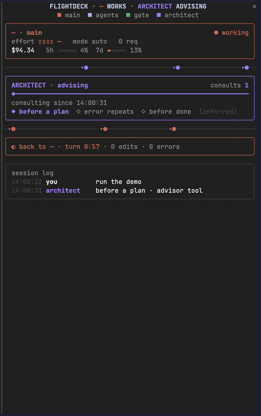

# Flightdeck

> 한국어판은 claude-code-mods-ko 프로젝트가 번역했습니다. 원작자와 라이선스는 문서 끝에 있으며, 영어 원문은 [README.en.md](README.en.md)에서 볼 수 있습니다.

[](https://github.com/scasella/claude-flightdeck/releases/latest)
[](LICENSE)
[](https://claude.com/blog/claude-code-mods)
[](https://statuslin.es/mods/flightdeck)

**터미널에 실시간 에이전트 대시보드를 표시하는 Claude Code 모드입니다.** 컨텍스트와 비용, 어드바이저 타임라인, 모든 권한 검사, 서브에이전트를 카드 또는 스윔레인으로 보여 줍니다. 모든 수치는 실제 세션 이벤트에서 나오며, 컴퓨터 밖으로 나가는 것은 없습니다.

<p align="center">
  
</p>

<p align="center">
  <a href="#install">설치</a> · <a href="#what-you-see">표시 내용</a> · <a href="#what-it-can-reach">접근 범위</a> · <a href="#configure">구성</a> · <a href="#troubleshooting">문제 해결</a> · <a href="CHANGELOG.md">새 소식</a>
</p>

## 설치

Claude Code(2.1.289 이상) 안에서 실행합니다.

```
/plugin marketplace add scasella/claude-flightdeck
/plugin install flightdeck@claude-flightdeck
/reload-plugins
/flightdeck
```

한국어 마켓플레이스에서는 다음 명령으로 설치합니다.

```
/plugin install flightdeck@claude-code-mods-ko
```

<details>
<summary><strong>터미널 또는 클론에서 설치</strong></summary>

```sh
claude plugin marketplace add scasella/claude-flightdeck
claude plugin install flightdeck@claude-flightdeck
```

또는 한 세션 동안 클론에서 바로 로드할 수 있습니다.

```sh
git clone https://github.com/scasella/claude-flightdeck
claude --plugin-dir ./claude-flightdeck
```

</details>

설치 프로그램이 구성 옵션이 설정되지 않았다고 말할 수 있지만 기본값으로 충분하며 [`/config`](#configure)에서 바꿀 수 있습니다.

모드는 Claude Code의 초기 액세스 기능이며 API가 릴리스마다 바뀔 수 있습니다. 문제가 생기면 [문제 해결](#troubleshooting)을 참고하세요.

## 표시 내용

https://github.com/user-attachments/assets/9ad0fcc3-c81c-427a-a743-f7b6c49f5885

<p align="center">
  
</p>

| 대화 옆에 도킹 | 프롬프트 위 인라인 |
| --- | --- |
|  | <br><br>전체 화면이 아닌 메인 화면에서는 패널이 최대 8줄 요약이며, 세션에 서브에이전트가 있으면 최대 3개가 함께 표시됩니다. |

| 패널 | 표시 내용 | 출처 |
| --- | --- | --- |
| **main** | 모델, 노력 수준, 권한 모드, 요청 수; 압축 표시가 있는 컨텍스트 게이지(⟲ 또는 [추정](#what-is-inferred-not-measured)일 때 ⟲~). 세션이 모델보다 작은 윈도우에서 압축되면 그 압축 윈도우 기준(`autoCompactWindow` 또는 Claude Code 자체 설정), 플랜이 보고할 때 비용과 처음 두 사용량 한도 윈도우 및 56열부터 각 초기화까지의 시간(↻), 마지막 메인 루프 요청의 첫 토큰까지의 시간 | `turn.step`, `session.measure`, `session.compact`, `$.session.usage()`(각 메인 루프 요청 시 및 모델별 한 번의 로컬 `summary` 분석), 권한 모드는 `classic.UserPromptSubmit`과 `agent.spawn` |
| **architect** | 타임라인의 자문, 진행 중 여부, 마지막 자문 소요 시간, 선택적으로 각 자문 시점, 서브에이전트 설계자 조언의 첫 줄 | 일치하는 에이전트 유형의 spawn 또는 어시스턴트 행의 일치하는 서버 도구 |
| **gate** | 권한 검사마다 한 칸: 묻지 않고 허용됨은 초록, 자동 모드 분류기 또는 사용자가 결정해 실행됨은 파랑, 대기는 호박색, 거부는 빨간 ✗, 서브에이전트 내부에서 이루어지면 흐리게. 합계와 도구 계열별 상세(자격 증명은 가림) | `tool.check`, 주변 `tool.call`로 확정 |
| **agents** | 공간이 되는 한 나란히 카드로 표시: 작업, 유형, 실시간 컨텍스트와 출력 토큰, 단계, 진행 시계, 빨간색 `max_tokens`. 그 이후에는 하나의 시간 축 위 스윔레인 | `agent.spawn`, `turn.step`, `tool.call`, `turn.complete` |
| **loops** | 어떤 카드에도 속하지 않는 모델 루프: 워크플로 에이전트, 압축, 메모리 포크 | 카드가 차지하지 않은 `turn.step` id |
| **receipt** | 진행 중이거나 마지막 턴: 지속 시간, 에이전트, 편집, 오류, 추가 비용 | `turn.start`, `turn.complete` |
| **log** | 프롬프트, spawn, 완료, 자문, 편집, 오류, 거부. 특정 에이전트의 트랜스크립트를 보는 동안에는 그 에이전트로 필터링 | 위의 모든 것 |

커넥터는 작업이 흐를 때만 움직입니다. 턴이 실행 중이거나, 에이전트가 실행 중이거나, 자문이 열려 있을 때입니다. 표시할 것이 없는 패널은 공간을 차지하지 않으므로 서브에이전트가 없는 세션에는 주 박스와 로그만 나옵니다.

## 사용법

| 명령 | 동작 |
| --- | --- |
| `/flightdeck` | 패널 열기 |
| `/flightdeck close` | 닫기 |
| `/flightdeck reset` | 에이전트, 검사, 자문, 로그, 턴을 지움(비용, 사용량 한도, 압축은 유지) |
| `/flightdeck layout auto\|compact\|wide\|mini` | 이 세션의 레이아웃을 덮어씀 |

`ctrl+x tab`으로 패널에 포커스를 두고 다음 키를 사용합니다.

| 키 | 동작 |
| --- | --- |
| `1`, `2`, … | 에이전트 카드 또는 레인 펼치기: 전체 작업, 최근 도구 호출 3개, 답변 시작 부분 |
| `f` `s` `o` | 권한 게이트의 파일 / 셸 / 기타 상세 열기: 최근 검사 5개와 판정 |

`/clear`는 대화와 함께 패널도 초기화합니다.

## 실행 위치

- **전체 화면 터미널:** 대화 옆에 도킹되며, 110열부터 두 열로 표시됩니다.
- **메인 화면 터미널:** 프롬프트 위 인라인으로 8줄 요약이 표시됩니다.
- **데스크톱 앱, VS Code, 모바일:** 같은 패널에 에이전트를 SVG 시간 축으로 그립니다. VS Code와 모바일에서는 애니메이션을 사용할 수 없어 커넥터와 시계가 정적입니다. VS Code 확장에는 아예 패널이 보이지 않을 수도 있습니다([문제 해결](#troubleshooting) 참고).

`openOnStart`를 켜면 세션이 시작될 때 패널이 자동으로 열립니다. 터미널 폭이 144열 이상일 때이며, 그 미만에서는 `/flightdeck`로 엽니다. 색상은 Claude Code 테마에서 가져오므로 밝은 테마, 어두운 테마, 색약 테마 모두 읽을 수 있습니다.

## 접근 범위

Flightdeck은 관찰만 합니다. 모든 훅이 이벤트를 그대로 통과시키며, 도구 호출, 프롬프트, 서브에이전트를 거부·수정·지연시키지 않습니다.

| 볼 수 있는 것 | 경로 |
| --- | --- |
| 모든 도구 호출의 이름과 입력, 실패 여부 | `tool.call` |
| 모든 권한 판정 | `tool.check` |
| 서브에이전트 spawn, 모델 요청, 토큰 사용량, 최종 답변 | `agent.spawn`, `turn.step`, `turn.complete` |
| 로그용 프롬프트의 첫 70자 | `turn.start` |
| 컨텍스트, 비용, 사용량 한도 수치 | `session.measure`, `$.session.usage()` |
| `/context`가 보여 주는 컨텍스트 분석(범주, 메모리 파일 경로, MCP 도구, 에이전트, 스킬). 모델별로 로컬에서 한 번 추정하며 압축 윈도우만 보관 | `$.session.usage({ breakdown: 'summary' })` |
| 어시스턴트 응답의 어드바이저 도구 호출(내용은 암호화됨) | `session.append` |

보관하는 것은 세션 상태의 짧은 요약(도구 이름과 경로 또는 명령, 각 프롬프트의 시작 부분, 에이전트의 작업과 답변, 설계자의 조언. 모두 자격 증명은 가림)이며 세션 종료와 함께 사라집니다. **네트워크 요청 없음, 프로세스 실행 없음, 파일 읽기·쓰기 없음, 세션 간 저장 없음, 모델 호출 없음.** `claude plugin validate .`이 훅과 호출 목록을 정확히 출력합니다.

## 추정된 값과 측정된 값

- **설계자 자문 시점.** "계획 전"은 이번 턴에 편집이 아직 없음을, "오류 반복"은 메인 루프 오류가 2회 이상 연속임을, "완료 전"은 편집이 있었음을 뜻합니다. `(inferred)`로 표시되며 `moments: false`로 끌 수 있습니다.
- **내장 가드 아래의 압축.** Claude Code의 가드가 Flightdeck에 `session.compact`를 전달하지 않을 때([문제 해결](#troubleshooting) 참고) 횟수를 추정합니다. Claude Code는 새 세션, `/clear`, 압축 후 첫 응답까지 컨텍스트 사용량을 보고하지 않습니다. 따라서 응답이 돌아온 뒤 사용량이 없으면 압축으로 셉니다. 주 박스에 `⟲~1`, 여유가 있으면 `(estimated)`가 표시되고 로그에는 `context compacted (estimated)`가 나옵니다. 첫 프롬프트로 되돌리는 것도 같으므로 압축으로 셉니다. `session.compact`가 실행되는 곳에서는 그 값이 추정치를 대체합니다.
- **서버 측 조언은 암호화되어 있음.** Claude Code의 `advisor` 같은 서버 도구의 경우 자문 횟수와 시간을 셀 수 있지만 내용을 표시할 수 없습니다.
- **에이전트별 컨텍스트는 최근 요청의 전체 입력**(캐시 미적용 + 캐시 읽기 + 캐시 쓰기)입니다. 비용이 아니라 `ctx`로 표시됩니다. API에 에이전트별 비용이 없기 때문입니다.
- **그 외 루프**는 워크플로 에이전트와 압축 포크를 구분할 수 없습니다. 둘 다 카드가 차지하지 않은 모델 루프입니다.
- **백그라운드 에이전트의 첫 단계**는 카드가 생기기 전에 도착할 수 있어 사용량이 한 단계 늦게 표시될 수 있습니다.
- **압축 윈도우 기준 컨텍스트.** 세션이 모델보다 작은 윈도우에서 압축되면 게이지, `tokens/window`, 상태 줄의 `ctx N%`가 그 윈도우를 기준으로 하므로 모델 윈도우를 기준으로 하는 Claude Code 상태 줄(및 claude-hud)의 비율보다 높게 읽힙니다. 자동 압축은 100%보다 조금 전, 그 윈도우 안의 임계값에서 실행됩니다.
- **첫 토큰까지의 시간.** `ttft`는 Flightdeck 자체 `turn.step` 훅에서 시간을 재므로 그 아래의 모든 것, 즉 다른 플러그인의 훅, 엔진, 네트워크, 재시도가 포함됩니다. 모델의 생각이 스트리밍되지 않으면 첫 조각이 그 뒤에 오므로 `ttft`에 생각이 포함됩니다. 측정값이지 추정은 아니지만 API 자체 수치는 아닙니다. 출력 속도는 없습니다. 보고된 토큰에 생각이 포함되므로 표시되는 스트림에 대한 속도는 실제 속도가 아닙니다.

## 구성

`/config` 또는 사용자 `settings.json`의 `pluginConfigs[<id>].options`에서 설정합니다. `<id>`는 Claude Code가 플러그인을 로드한 방식입니다. 마켓플레이스에서 설치했다면 `flightdeck@claude-flightdeck`, `--plugin-dir`이면 `flightdeck`(또는 `flightdeck@inline`). 다른 키 아래나 프로젝트 설정(`.claude/settings.json`)의 항목은 경고 없이 무시됩니다. 터미널에서는 `claude plugin configure flightdeck@claude-flightdeck`가 옵션과 설정되지 않은 것을 나열하고 `--values-stdin`으로 저장합니다.

| 옵션 | 기본값 | 의미 |
| --- | --- | --- |
| `architectPattern` | `advisor\|architect` | 설계자로 셀 에이전트 유형과 서버 도구에 대한 대소문자 무관 정규식 |
| `matchDescriptions` | `false` | 유형 이름뿐 아니라 에이전트 설명도 일치시킴 |
| `architectLabel` | `ARCHITECT` | 패널에서 설계자의 이름 |
| `gateLabel` | `GATE` | 권한 패널의 이름 |
| `panels` | `main,architect,gate,agents,loops,receipt,log` | 표시할 패널과 순서 |
| `layout` | `auto` | `mini`, `compact`, `wide`, `auto`(인라인은 mini, 110열부터 도킹은 wide) |
| `maxCards` | `3` | 스윔레인으로 전환하기 전 나란한 카드 수(1~6). 패널이 좁으면 줄어듦 |
| `paneColumns` | `66` | 도킹 패널이 요청하는 열 수, 40 이상. Claude Code는 도킹을 터미널의 45%로 제한하며, 이번 세션이나 이전 세션에서 드래그한 폭이 우선합니다. wide 레이아웃은 110열부터 시작하므로 약 245열 터미널이 필요하거나 `layout: wide`를 사용해야 합니다 |
| `motion` | `while-active` | `off`는 커넥터를 정지시킴 |
| `moments` | `true` | 추정된 자문 시점을 표시 |
| `palette` | `theme` | `pastel`은 어두운 터미널용으로 조정된 고정 색상 |
| `openOnStart` | `true` | 세션 시작 시 패널을 열지 묻기 |
| `statusLine` | `true` | 상태 줄에 컨텍스트, 실행 중 에이전트, 자문, 거부 표시 |

## 문제 해결

**패널이 나타나지 않습니다.**
- `claude --version`이 2.1.289 이상인지 확인한 뒤 `/reload-plugins`, `/flightdeck`를 실행하세요. 이전 버전에서는 트랜스크립트에 `flightdeck: hooks module did not load: …`이 나옵니다.
- 144열 미만에서는 Claude Code가 요청하지도 않은 패널을 배치하지 않습니다. `/flightdeck`는 어떤 폭에서도 엽니다.
- 트랜스크립트에서 `flightdeck:`로 시작하는 흐린 줄을 찾아보세요. 실패한 훅이나 패널이 거부된 이유가 나옵니다. 그 내용을 포함해 [이슈를 열어 주세요](https://github.com/scasella/claude-flightdeck/issues).
- 패널에 `draw failed (…)`만 표시되면 그리기 훅이 예외를 던진 것입니다. 그 줄도 이슈에 포함하세요.

**VS Code 확장에 아무것도 표시되지 않습니다.** 한 보고에 따르면 2.1.296 빌드가 Flightdeck 훅을 실행했지만 패널을 보여 주지 않았고 다른 모드의 패널도 없었습니다([#5](https://github.com/scasella/claude-flightdeck/issues/5)). 대신 VS Code의 통합 터미널에서 `claude`를 실행한 뒤 `/flightdeck`를 사용하세요. 통합 터미널은 자동 개방에 필요한 144열보다 좁은 경우가 많습니다.

**Team 또는 Enterprise 로그인에서 권한 모드가 없거나 오래되고, 압축이 추정됩니다.** 관리형 설정이 있는 컴퓨터나 Team/Enterprise `/login` 세션에서 Claude Code는 `cc-plugin-sec-default` 내장 가드를 로드합니다. 이 가드는 사용자가 설치한 플러그인의 훅을 `classic.*` 이벤트나 `session.compact`에서 실행하지 않습니다([조직의 모드 관리](https://code.claude.com/docs/en/plugins/mods/admin)의 "Know which hooks of a user's mod don't run" 참고). 권한 모드를 전달하는 다른 이벤트는 서브에이전트 시작뿐입니다. 따라서 서브에이전트가 시작될 때까지 주 박스에 모드가 없고, 그 후에는 시작 시점의 모드가 표시됩니다. 그 전까지 자동 모드에서는 게이트가 분류기가 허용한 호출을 `you`로 처리합니다. 압축은 각 요청에서 Claude Code가 보고하는 컨텍스트로 세기 때문에 주 박스에 `⟲~`, 로그에 `context compacted (estimated)`가 나옵니다([추정된 값과 측정된 값](#what-is-inferred-not-measured) 참고). 2.1.299 이상에서는 `/plugin`이 두 훅을 지정하는 알림을 표시합니다. 패널의 나머지는 정상 동작합니다. 관리자가 Flightdeck을 조직 자체 모드 중 하나로 설치하면 훅이 실행되도록 할 수 있습니다([#23](https://github.com/scasella/claude-flightdeck/issues/23)).

**옵션이 무시되는 것 같습니다.** 사용자 `settings.json`의 키를 확인하세요. 설치했다면 `pluginConfigs["flightdeck@claude-flightdeck"]`, `--plugin-dir`이면 `pluginConfigs["flightdeck"]`. [구성](#configure) 참고.

**색상이 이상합니다.** `/config`에서 `palette`를 `pastel`로 설정하세요.

**움직임이 너무 많습니다.** `motion`을 `off`로 설정하세요.

**업데이트 후 카운터가 오래된 것 같습니다.** `/flightdeck reset`을 실행하세요.

## 동작 방식

| 파일 | 내용 |
| --- | --- |
| [`hooks/register.tsx`](hooks/register.tsx) | 이벤트 훅, 상태 접근, 패널별 함수 |
| [`hooks/core.ts`](hooks/core.ts) | 모든 reducer, 포맷터, 레이아웃 규칙을 순수 함수로 구현해 동작을 직접 테스트할 수 있게 함 |
| [`hooks/rail.tsx`](hooks/rail.tsx), [`hooks/elapsed.tsx`](hooks/elapsed.tsx) | 표면 모듈: 애니메이션 커넥터와 실시간 시계가 자체 프레임 클록으로 자신만 다시 그림 |
| [`types/index.d.ts`](types/index.d.ts) | 상태 계약 |
| [`tests/`](tests) | 65개 테스트: 순수 동작과 24~120열의 모든 표면에 장착된 그리기. 24~40열의 모든 폭에서 상자를 넘치는 것이 없는지 검사 |

상태는 `$.state` 원자에 있습니다. 모든 읽기는 기본값 위에 병합되므로 필드가 없거나 오래되어도 패널이 깨지지 않습니다. 상태 모양을 바꾸는 업데이트는 카운터를 한 번 초기화할 수 있습니다. 모드가 처음이라면 [Claude Code mods](https://claude.com/blog/claude-code-mods)와 [Getting started with Claude Code mods](https://claude.dev/blog/getting-started-with-claude-code-mods/)를 참고하세요.

## 관련 프로젝트

Flightdeck은 다음과 함께 사용하며 아이디어를 얻었습니다.

- [claude-hud](https://github.com/jarrodwatts/claude-hud): 상태 줄의 컨텍스트, 한도, 도구, 에이전트. 둘 다 쓰세요. 하나는 상태 줄이고 이것은 패널입니다.
- [zoetrope](https://github.com/furkankly/zoetrope): Claude Code 또는 Codex 세션을 실시간 흐름 그래프로 표시.
- [ccusage](https://github.com/ccusage/ccusage): 세션 로그에서 비용 보고서 생성.
- [awesome-claude-code-mods](https://github.com/karanb192/awesome-claude-code-mods): Claude Code 모드 색인.

## 개발

```sh
claude --plugin-dir .            # load it; edits hot-reload
claude plugin validate .
claude plugin test .
npx -p typescript tsc -p .       # after the first load, which writes .claude-plugin/types/
```

[CONTRIBUTING.md](CONTRIBUTING.md)를 참고하세요. 변경 사항은 [CHANGELOG.md](CHANGELOG.md)에 있습니다.

## 라이선스

[MIT](LICENSE)

## 출처 및 라이선스

- 원작자: [scasella](https://github.com/scasella/flightdeck)
- 원본 저장소: https://github.com/scasella/flightdeck
- 라이선스: MIT
- 한국어 번역 및 UI 현지화: claude-code-mods-ko 프로젝트
