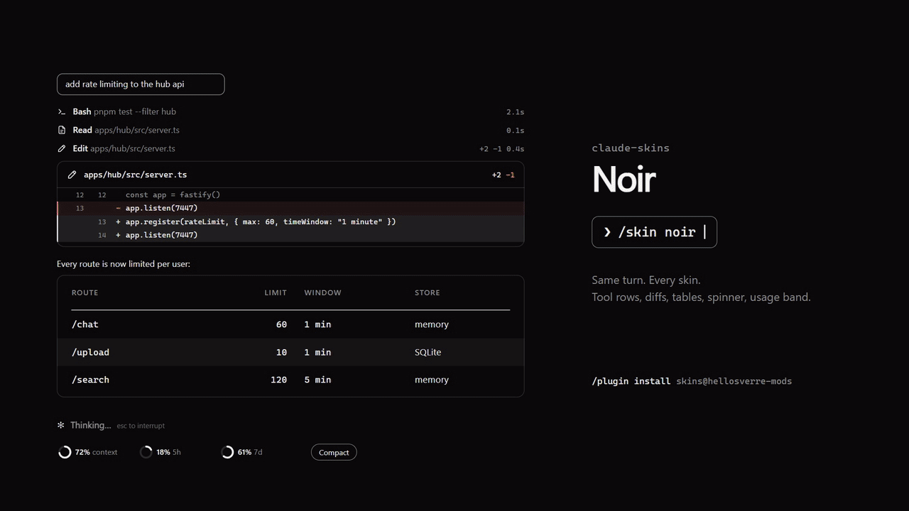

<h1 align="center">
  <picture>
    <source media="(prefers-color-scheme: light)" srcset="docs/brand/banner-light.svg">
    
  </picture>
</h1>

> 한국어판은 claude-code-mods-ko 프로젝트가 번역했습니다. 원작자와 라이선스는 문서 끝에 있으며, 영어 원문은 [README.en.md](README.en.md)에서 볼 수 있습니다.

<p align="center">
  <a href="https://github.com/hellosverre/claude-skins/releases/latest"></a>
  <a href="LICENSE"></a>
  
</p>

<p align="center">아이콘과 소요 시간이 있는 도구 호출, diff 카드로 표시되는 편집, 표·코드·Mermaid 차트 카드,<br>실시간 사용량 띠, 다시 칠하거나 Claude에 디자인을 맡길 수 있는 열여섯 가지 스킨.</p>



## 설치

Claude Code **2.1.287** 이상이 필요하며 터미널이나 데스크톱 앱의 Code 탭에서 사용할 수 있습니다. Claude Code 안에서 두 명령을 모두 실행하세요.

```
/plugin marketplace add hellosverre/claude-skins
```

```
/plugin install skins@hellosverre-mods
```

Claude Code를 재시작하세요. **noir** 스킨이 켜져 있으며, `/skin`으로 바꿀 수 있습니다.

다른 모드를 찾고 있나요? `/plugin install mod-store@hellosverre-mods`를 설치한 뒤 `/mods`로 약 2,700개를 패널에서 찾아보고 설치할 수 있습니다. 각 모드가 접근할 수 있는 것을 먼저 보여 줍니다.

한국어 마켓플레이스에서는 다음 명령으로 설치합니다.

```
/plugin install skins@claude-code-mods-ko
```

## 업데이트

skins는 하루 한 번 새 릴리스를 확인하고 뒤처지면 알림을 표시합니다. 업데이트하려면:

```bash
claude plugin marketplace update hellosverre-mods
```

```bash
claude plugin update skins@hellosverre-mods
```

그다음 Claude Code를 재시작하세요. 이미 열린 세션은 시작할 때의 버전을 유지합니다.

## 제거

```bash
claude plugin uninstall skins@hellosverre-mods
```

설치는 유지한 채 Claude Code 자체 그리기로 돌아가려면 `/skin off`를 실행하세요.

## 사용법

`/skin help`는 Claude Code의 모든 명령을 나열하고, `/skin list`는 모든 스킨과 설정을 보여 줍니다.

**스킨**

| 명령 | 동작 |
|---|---|
| `/skin` | 설정: 실시간 미리 보기로 스킨 선택, 부분 켜기·끄기, 모든 색상 다시 칠하기 |
| `/skin <name>` | 스킨 전환(이름은 아래) |
| `/skin list` | 내 스킨을 포함한 모든 스킨과 모든 설정 |
| `/skin help` | 모든 명령을 표로 표시 |
| `/skin off` · `on` | Claude Code 자체 그리기로 돌아가기, 또는 skins 다시 켜기 |
| `/skin gallery` | 스킨이 그리는 모든 요소를 번호를 매워 가리킬 수 있게 표시 |
| `/skin pin` · `unpin` · `share` | 이 폴더에 자체 외형 지정, 해제, 기본값으로 만들기 |
| `/skin copy` · `copy code` | Claude의 마지막 답변 또는 마지막 코드 블록만 복사 |
| `/skin calm` · `calm off` | 움직임 없음, 도구 행마다 한 줄, 읽기 전용 출력 접기, 실패는 항상 전체 표시. `calm off`는 이전 상태로 되돌림 |

내장 스킨: `noir`, `tokyo-night`, `dracula`, `catppuccin`, `rose-pine`, `nord`, `gruvbox`, `kanagawa`, `everforest`, `one-dark`, `solarized`, `night-owl`, `ayu`, `github`, `mono`, `terminal`.

**옵션**

| 명령 | 동작 |
|---|---|
| `/skin tables on/text/off` | 표를 카드로, 데스크톱에서는 선택 가능한 텍스트로, 또는 Claude Code 자체로 표시 |
| `/skin prompt left/right/plain` | 터미널에서 프롬프트 외곽선이 어느 쪽에 오는지, 또는 단순 선행 표시. 데스크톱은 복사·되돌리기가 있는 Claude Code 자체 메시지를 유지 |
| `/skin words claude/skin` | 스피너와 턴 하단에 누구의 문구를 쓸지: Claude Code 자체 또는 스킨(기본값) |
| `/skin icons unicode/ascii` | 아이콘 세트, 터미널에서는 ASCII 전용 도표 |

**부분**, 각각 `/skin <part> on` 또는 `off`로 전환:

| 부분 | 동작 |
|---|---|
| `rail` | 도구 행 옆의 색 줄 |
| `shimmer` | 스피너 단어를 가로지르는 빛 띠 |
| `band` | 프롬프트 위 사용량 게이지 |
| `countdown` | 띠에서 각 한도의 남은 시간 |
| `compact` | 띠의 Compact 버튼, 컨텍스트 70%부터 알림(기본 켜짐) |
| `clip` | Claude Code 자체 셸 출력을 앞뒤만 남도록 자르기 |
| `markdown` | 경고와 작업 목록 그리기 |
| `quiet` | 읽기, 검색, 읽기 전용 명령을 한 줄로 접기 |
| `charts` | mermaid 코드 블록을 차트로 그리기 |
| `math` | 수식 조판 |
| `commands` | 슬래시 명령 출력을 표와 카드로 |
| `shell` | 셸 출력을 카드로 |
| `highlight` | 코드 블록을 스킨 색상으로 강조 |
| `hints` | 차트가 여기 그려진다고 Claude에 알림 |
| `links` | URL과 경로를 링크로 |
| `copy` | 카드에 복사 버튼 |
| `fold` | 긴 블록을 `▾ N more` 뒤에 접기 |
| `expand` | 읽기·검색 연속을 한 줄(`Read 3 · Search 2 ▸`) 대신 모두 펼치기, 기본은 꺼짐 |

**Claude와 함께 디자인하기.** "노을 같은 스킨 만들어 줘"라고 요청하세요. skins가 Claude에 `design` 도구를 주므로 스킨을 만들고 사용자가 보는 앞에서 적용합니다. 내장 스킨을 다시 칠하면 `my-<skin>`으로 저장됩니다. 선택은 세션 간 기억됩니다.

## 미리 보기

스크린샷이 아니라 모드 자체 카드 코드(`scripts/previews.ts`)로 그렸습니다.

<picture>
  <source media="(prefers-color-scheme: light)" srcset="docs/previews/hero-light.svg">
  
</picture>

<picture>
  <source media="(prefers-color-scheme: light)" srcset="docs/previews/spinners-light.svg">
  
</picture>

<picture>
  <source media="(prefers-color-scheme: light)" srcset="docs/previews/terminal-light.svg">
  
</picture>

<picture>
  <source media="(prefers-color-scheme: light)" srcset="docs/previews/code-light.svg">
  
</picture>

<picture>
  <source media="(prefers-color-scheme: light)" srcset="docs/previews/usage-light.svg">
  
</picture>

## 다시 그리는 것

| 부분 | 데스크톱 앱 | 터미널 |
|---|---|---|
| 도구 호출 | 종류별 아이콘, 실행 중 스피너, 변경 줄 수, 소요 시간. `▸`로 행을 열면 호출 입력 전체와 답변(줄 번호가 있는 읽기 텍스트, 검색 일치, 셸 카드, diff)이 나옴. 실패한 호출은 저절로 열림 | 턴 레일의 노드, 같은 `▸` |
| 편집 | `+N −M`과 번호가 있는 줄의 diff 카드 | Claude Code 자체 diff |
| 셸 명령 | 상태, 분리된 stderr, 긴 출력 접기가 있는 터미널 카드. 경로·숫자·오류·경고·통과 단어에 색 적용 | 명령이 있는 카드, 같은 방식으로 색이 있는 출력, `✓` 또는 `✗ exit N`, 자체 레이블 아래 빨간 stderr, 각 스트림을 8+4줄로 접기(`/skin shell off`로 Claude Code 자체로) |
| 조용한 출력(기본 꺼짐) | 읽기·검색·읽기 전용 명령이 한 줄로 접힘. 실패는 오류 줄 유지 | 동일 |
| 표 | 머리 줄, 줄무늬 행, 색 견본이 있는 카드 | 머리 띠가 있는 셀 그리드 |
| 차트 | ` ```mermaid `를 카드로: 흐름도, xy, 파이, 간트, 타임라인, 여정, 칸반, 마인드맵, 사분면, 레이더, 산키, gitGraph, 트리맵, 패킷, 블록, 아키텍처, C4 | 같은 열일곱 종류를 셀로, `/skin icons ascii`로 ASCII |
| 수식 | `$$…$$`, `\[…\]`, ` ```math `를 조판 카드로: 분수, 근, 합, 극한이 있는 적분, 행렬, 정렬된 줄. `$…$` 인라인은 유니코드로 | 분수와 극한을 셀에 쌓고, 인라인 `$…$`은 유니코드 |
| 명령 출력 | `/cost`, `/context`, 플러그인 출력의 표·코드·`key: value` 연속을 카드로 | 셀 그리드로 동일 |
| 경고와 작업 목록 | `> [!NOTE]`를 제목 있는 상자로, `- [ ]`를 체크와 완료 횟수로 | 동일 |
| 코드 블록 | 언어·줄 번호·강조가 있는 카드. 셸 블록은 Run 버튼 유지 | 테두리와 언어가 표시되고 스킨 색으로 강조: TS/JS, JSON, 셸, PowerShell, Python, Rust, Go, C/C++, C#, F#, Java, YAML, TOML, HTML/XML, CSS, SQL, diff, Markdown, Lua(`/skin highlight off`로 Claude Code 자체로) |
| 스피너 | 단계별 애니메이션 아이콘 | 빛 띠가 있는 스킨의 단어 |
| 프롬프트 위 | 컨텍스트·플랜 한도 링, Compact 버튼, 70% 알림 | 블록 게이지, 같은 버튼 |
| 사용자 프롬프트 | Claude Code 자체이므로 복사·되돌리기·선택 유지 | 둥근 외곽선 또는 단순 표시 |
| 링크와 파일 | URL은 앱 자체 링크, 도구 행은 이번 턴에 생성(`ok`)·편집(`warn`)된 파일에 색 | 산문의 URL은 터미널이 그리는 곳에서는 OSC 8 링크(`FORCE_HYPERLINK=1` 또는 `0`으로 검사 재정의), 그 밖은 일반 텍스트. `:line`이 있는 경로, 숫자, 버전에 색, 이번 턴 파일은 행과 산문에서 `ok` 또는 `warn` |
| diff 코드 블록 | ` ```diff `를 Copy와 `new only`(변경 후 코드)가 있는 diff 카드로 | 번호가 있는 이전·이후 줄, `+`와 `-`에 스킨 색, 코드는 `+++` 경로 또는 ` ```diff-fsharp ` 태그가 지정한 언어로 강조, 같은 두 가지 복사 |
| 나란히 | 두 개 이상의 표·차트가 한 줄에 있을 때 각각 75열이면 공유, 아니면 쌓음 | 자연 폭이 맞는 한 셀 그리드와 도표를 나란히, 아니면 쌓음 |
| 긴 블록 | 24줄을 넘는 코드 카드는 그곳에서 자르고 `▾ N more` | 24줄 초과 코드, 14행 초과 표, 8+4줄 초과 셸 출력이 `▾ N more` / `▴ less` 뒤에 접힘 |

모든 카드에는 Copy 버튼이 있고(표는 `as text`, 그려진 상태 그대로, 여러 블록으로 된 답변은 끝에 `copy reply`) 첫 그리기 때 한 번 애니메이션하며Reduced motion 설정을 존중합니다. 바뀌는 것은 그리기뿐이며 저장된 대화와 모델이 읽는 내용은 그대로입니다. 에이전트, 플랜 모드, 권한 요청은 Claude Code 자체 그리기를 유지합니다.

**차트 힌트.** 차트가 켜져 있으면 Claude가 짧은 모델 전용 메모(약 130토큰, 458자에서 추정)를 받아 ` ```mermaid ` 블록이 여기서 그려진다고 알게 되므로 차트가 더 나을 때 차트를 씁니다. 헤드리스 `claude -p` 실행에는 절대 보내지 않습니다. `/skin hints off`로 메모를 끄고 차트 그리기는 유지합니다.

**밝기와 어두움.** 모든 스킨에 두 버전이 있고 Claude Code 테마를 따릅니다. `auto`에서는 터미널(`COLORFGBG`)이나 시스템을 따르며, `SKINS_THEME=light` 또는 `SKINS_THEME=dark`로 고정할 수 있습니다.

**터미널 색상.** `terminal` 스킨은 터미널 자체의 16색 팔레트(`ansi256(0)`~`ansi256(15)`)로 칠하므로 터미널 테마가 밝든 어두운든 그대로 따릅니다. 본문과 표 띠는 Claude Code 자체 테마 색을 쓰며, `/config`에서 ANSI 테마를 고르면 그것도 터미널을 따릅니다. 데스크톱 앱에는 터미널 팔레트가 없어 `noir`로 그립니다.

## 다른 모드를 위하여

skins는 `$`에 `$.skins.markdown`을 추가합니다. skins가 답변을 그리는 방식으로 마크다운을 사용자의 스킨으로 그립니다. 트리를 반환하거나, skins가 꺼져 있거나 그릴 것이 없는 텍스트이면 `undefined`를 반환하고, 잘못된 인자에는 오류를 던집니다. 복사·접기 컨트롤은 그리지 않습니다. 누름이 모드 간 트리를 넘지 못하기 때문입니다. `plugin.json`의 `dependencies`에 `skins`를 나열하면 Claude Code가 타입을 `.claude-plugin/types/`에 넣어 줍니다.

```tsx
let drawn
try {
  drawn = await $.skins.markdown({ surface: e.surface, text, columns: e.props.bodyColumns })
} catch {}
return drawn ?? <Markdown text={text} />
```

## 호환성

Windows(터미널·데스크톱 앱, 0.3.0)에서 수동 확인하고 Linux(터미널, 0.5.0, Claude Code 2.1.288, 엔진 테스트 168개)에서 실행했습니다. [CI](.github/workflows/ci.yml)가 Linux, Windows, macOS에서 테스트, 매니페스트 검사, 타입 검사를 실행합니다. macOS, VS Code, 모바일은 수동으로 살펴보지 않았습니다. 표면 × OS 행렬과 줄별 렌더 시간은 [docs/compat.md](docs/compat.md)에 있습니다. 직접 측정하려면:

```bash
scripts/bench.sh
```

## 알려진 제한

| 대상 | 대신 제공되는 것 | 위치 |
|---|---|---|
| 이미지·PDF·노트북 읽기, 백그라운드 명령, 읽을 수 없는 답변이 열린 행 | 열린 행 안에 Claude Code 자체 행 | [`hooks/detail.ts`](hooks/detail.ts)의 `bodyOf`, 테스트 "an opened image Read is Claude Code's own drawing…" |
| 에이전트, 플랜 모드, 할 일, 권한 요청 | Claude Code 자체 행과 대화상자 | [`hooks/tools.ts`](hooks/tools.ts)의 `kindOf`, 테스트 "tools a skin cannot redraw faithfully keep their own row" |
| 터미널의 편집, 모든 곳의 실패한 편집 | Claude Code 자체 diff | [`hooks/register.tsx`](hooks/register.tsx) `ToolResult`, 테스트 "on the desktop an edit is a diff card…" |
| 강조기가 모르는 언어의 터미널 코드 블록 | Claude Code 자체 마크다운 | [`hooks/highlight.ts`](hooks/highlight.ts)의 `languageOf`, 테스트 "a fence in a language it does not know keeps Claude Code's markdown" |
| 데스크톱의 셸 블록(` ```bash `) | 앱 자체 블록이므로 Run 버튼 유지 | 테스트 "on the desktop a shell fence keeps the app's own block" |
| 데스크톱의 시퀀스·상태·클래스·ER 도표 | 코드 카드, 터미널에 번들된 레이아웃만 그림 | [`hooks/mermaid-art.ts`](hooks/mermaid-art.ts)의 `artKind`, [`hooks/mermaid.ts`](hooks/mermaid.ts)의 `parseMermaid` |
| 터미널 도표의 노드 id나 상태 이름에 한글·중국어·일본어 등 넓은 문자(`A[開始] --> 請求`) | 코드로 표시. 번들 레이아웃이 그런 노드를 버림. 넓은 레이블은 아트로 그림 | [`hooks/mermaid-art.ts`](hooks/mermaid-art.ts)의 `drawsWide`, 테스트 "a diagram the renderer cannot lay out with wide characters falls back to code" |
| 너무 넓거나 긴 도표(터미널에서 80줄 또는 8,000자 초과) | 흐름도·xy·파이는 행, 그 외는 코드 | 테스트 "a diagram too wide for the terminal falls back to rows…" |
| 9,000자 초과 답변 블록, 4,000자 초과 프롬프트 | 전체 메시지에 Claude Code 자체 그리기 | [`hooks/register.tsx`](hooks/register.tsx)의 `MAX_MARKDOWN`, `MAX_PROMPT` |
| 80줄 초과 코드 카드 | 처음 80줄과 `N more lines` 메모, Copy는 전체 | [`hooks/svg-code.ts`](hooks/svg-code.ts)의 `MAX_LINES` |
| 파서가 모르는 TeX 명령 | `\name`으로 그대로 그림 | [`hooks/math.ts`](hooks/math.ts) |
| 터미널과 데스크톱의 셸 출력 차이 | 터미널 카드는 명령을 이름으로 표시하고 각 스트림을 8+4줄로 접음. 데스크톱 카드는 `Output`이라고 하고 두 스트림을 함께 6+6줄로 접음 | [`hooks/shell-rows.tsx`](hooks/shell-rows.tsx), [`hooks/svg-terminal.ts`](hooks/svg-terminal.ts) |
| 실패한 셸 호출이 기록 대신 오류 텍스트를 넘길 때 | stdout과 stderr가 합쳐져 전체 텍스트가 stderr로 그려짐 | [`hooks/shell.ts`](hooks/shell.ts)의 `shellResultOf` |
| 백그라운드로 보낸 명령이나 이미지 출력 | 어디로 갔는지 알려 주거나 이미지를 그리는 Claude Code 자체 행 | [`hooks/shell.ts`](hooks/shell.ts)의 `keepsOwnRow`, 테스트 "/skin shell off gives shell output back…" |
| `/resume` 이후 셸 카드와 도구 소요 시간 | 헤더에 명령도 시간도 없음. 둘 다 호출 시 기록됨 | [`hooks/register.tsx`](hooks/register.tsx)의 `commandAtom`, `durationAtom` |
| 슬래시 명령 오류와 `/skin` 자체 출력 | Claude Code 자체 행 | 테스트 "slash-command output with key: value lines is a table, prose keeps its row" |
| `/skin calm`과 Claude Code 스피너 | calm이 스피너를 Claude Code에 넘기고 자체 스피너가 계속 움직임 | [`hooks/register.tsx`](hooks/register.tsx)의 `Spinner` |
| 모바일의 설정 패널 | 터미널이나 데스크톱 앱을 쓰라는 줄 | [`hooks/register.tsx`](hooks/register.tsx)의 `Pane` |
| 파일 경로를 링크로 | 색만 있고 클릭 불가. 엔진의 `Link`는 `https:`와 `http://localhost`만 받음 | [`hooks/links.ts`](hooks/links.ts)의 `safeHref` |
| 데스크톱 접기 | 코드 카드만 접힘. 표 카드와 셸 카드는 전체 높이 또는 자체 6+6 접기를 유지 | [`hooks/fold.tsx`](hooks/fold.tsx) |
| 아이콘과 레일 | 아이콘은 데스크톱 전용(터미널은 `Svg`를 그리지 않음), 레일은 터미널 전용 | [`hooks/register.tsx`](hooks/register.tsx)의 `lookOf` |

## 비교 대상

대화 외형을 바꾸는 다른 모드들의 2026-10-10자 README입니다. 빈 칸은 README에 언급이 없음을 뜻합니다.

| | skins | [Prismantis](https://github.com/NahumLitvin/prismantis) | [glint](https://github.com/manikosto/glint) | [tweakcc](https://github.com/Piebald-AI/tweakcc) | [claude-gfm-render](https://github.com/briangtn/claude-gfm-render) | [ccstatusline](https://github.com/sirmalloc/ccstatusline) |
|---|---|---|---|---|---|---|
| 방식 | 함수 훅 플러그인 | 함수 훅 플러그인 | 함수 훅 플러그인, Prismantis 포크 | Claude Code의 JavaScript에 패치, 업데이트마다 다시 적용 | 함수 훅 모드 | 상태 줄 명령 |
| Claude Code | 2.1.287+ | 2.1.287+ | 2.1.289+ | 2.1.162에서 검증 | 2.1.286+ | |
| 명시된 플랫폼 | Windows 수동, Linux 테스트, CI는 Linux·Windows·macOS([compat](docs/compat.md)) | macOS 터미널 수동, CI는 macOS·Linux·Windows | | Windows, macOS, Linux | 터미널과 데스크톱 앱 | 문서에 Windows 안내 |
| 테마 | 16, 모든 색 재칠하기, Claude가 디자인 | 15와 `mono`, 20개 색 슬롯 | 15 | 사용자 자신의, Claude Code 전체 UI용 | | Powerline 테마 |
| Claude Code 자체 UI 색 변경 | 아니요 | 아니요 | 아니요 | **예** | 아니요 | 아니요 |
| 도구 행 | 아이콘, 소요 시간, 레일, **입력과 답변까지 열림** | 4가지 스타일 | | | 아니요 | 아니요 |
| 읽기 전용 출력 숨김 | `/skin quiet` | `toolOutput: quiet` | | | 아니요 | 아니요 |
| 편집 diff | 데스크톱은 카드, 터미널은 열린 행의 엔진 diff | Claude Code 자체 | | | 아니요 | 아니요 |
| ` ```diff ` 블록 | diff 카드 또는 번호 행, `new only` 복사 | | 번호, `⧉ new only` | | | 아니요 |
| 셸 출력 | 두 표면 모두 카드, 경로·숫자·오류에 색 | 펼친 그룹 안에 상자 | | | 아니요 | 아니요 |
| 터미널 코드 강조 | 스킨 색의 20개 언어 계열 | Prism, 스무 언어 이상 | 20개 이상 언어 | | | 아니요 |
| 표 | 카드 또는 셀 그리드, 도표와 나란히 | 4가지 스타일, 도표와 나란히 | | 4가지 형식 | 아니요 | 아니요 |
| Mermaid | 17종, 시퀀스·상태·클래스·ER은 터미널 전용 | 흐름도, 시퀀스, 상태, 클래스, ER, xy, 파이 없음 | 흐름도, 시퀀스, xy | | 흐름도, 시퀀스, 상태, 클래스, ER, xy, 데스크톱 SVG | 아니요 |
| 수식 | 데스크톱 카드, 터미널 셀 쌓기 | kitty·Ghostty에서 RaTeX로 조판 이미지, 그 외 텍스트 | | | 처리하지 않음 | 아니요 |
| 링크 | URL은 OSC 8 링크, 이번 턴 파일에 색 | 링크와 벗어난 URL 클릭 가능 | **URL과 파일 경로 클릭 가능**, 변경 파일에 색, 링크 띠 | | | 아니요 |
| 긴 블록 접기 | 코드, 표, 셸 출력(`/skin fold`) | | 코드, 목록, 표 | | | 아니요 |
| 오른쪽에서 왼쪽으로 쓰는 텍스트 | 아니요 | **히브리어와 아랍어** | 히브리어와 아랍어 | | | 아니요 |
| 사용량 게이지 | 프롬프트 위 컨텍스트·플랜 한도 | | | | 아니요 | **많은 위젯**, Powerline |
| 스피너 단어 | 스킨 단어, 반짝임 | | | **사용자 정의 동사와 애니메이션** | 아니요 | 아니요 |
| 복사 | 카드, 표를 마크다운 또는 그려진 상태로, `copy reply`, `/skin copy` | 버튼, `/prismantis copy`, HTML 표 | 코드, 표, 도표, 목록, 인용 | | | 아니요 |
| 다른 모드를 위한 API | `$.skins.markdown` | `$.prismantis.markdown` | | | | 아니요 |

더 나은 지점: **tweakcc**는 바이너리에 패치하는 대가로 훅이 다시 그릴 수 있는 것만이 아니라 Claude Code 전체 색을 바꿉니다. **Prismantis**는 오른쪽에서 왼쪽으로 쓰는 텍스트를 처리하고 표를 HTML로 복사하며 수식을 이미지로 조판합니다. **glint**는 파일 경로를 클릭 가능하게 하고 마지막 답변의 링크 띠를 유지합니다. **ccstatusline**은 상태 줄이 훨씬 깊습니다. **claude-gfm-render**는 데스크톱에서 시퀀스 등의 도표를 SVG로 그리며, skins는 여기서 코드 카드로 대체합니다. skins의 다음 계획은 [ROADMAP.md](ROADMAP.md)에 있습니다.

## 프라이버시

skins는 그리기와 기억만 합니다. 세션 디렉터리, 컨텍스트·플랜 사용량, 테마 설정, `SKINS_THEME` / `COLORFGBG`를 읽고 설정을 모드 저장소에 보관합니다. 유일한 네트워크 호출은 하루 한 번 버전 확인으로, 이 저장소의 [`plugin.json`](.claude-plugin/plugin.json)을 `raw.githubusercontent.com`에서 GET하며 아무것도 보내지 않습니다. `auto`에서는 운영체제에 밝은·어두운 모드를 묻습니다(macOS에서는 `defaults`, GNOME에서는 `gsettings`). 압축이나 복사는 버튼을 누를 때만 합니다. `claude plugin validate .`로 직접 확인하세요.

## 번들 코드

터미널 도표 레이아웃은 [beautiful-mermaid](https://github.com/lukilabs/beautiful-mermaid)(MIT)가 담당하며, 라이선스가 헤더에 있는 `hooks/vendor/mermaid-ascii.js`에 포함되어 있습니다. 다시 빌드하려면:

```bash
cd scripts/vendor && npm install && npm run build
```

## 개발

```bash
git clone https://github.com/hellosverre/claude-skins && cd claude-skins
```

```bash
claude --plugin-dir .
```

파일을 저장하면 실행 중인 세션에서 모드가 다시 로드됩니다. 테스트: `claude plugin test .`. 미리 보기: `npx tsx scripts/previews.ts`. 새 내장 스킨은 파일 하나입니다. `hooks/themes/nord.ts`를 복사하고 색과 단어를 바꾼 뒤 `hooks/themes/index.ts`에 줄을 추가하세요.

## 다른 모드

- [redgreen](https://github.com/hellosverre/redgreen): 채팅 옆 패널의 테스트 결과
- [smart-compact](https://github.com/hellosverre/smart-compact): 커밋 후, 초록 테스트 후, 프롬프트 캐시 만료 전, 또는 Claude가 요청할 때 압축
- [mod-store](https://github.com/hellosverre/mod-store): 패널에서 2,700개 모드 탐색·검색·설치

## 라이선스

MIT

## 출처 및 라이선스

- 원작자: [hellosverre](https://github.com/hellosverre/claude-skins)
- 원본 저장소: https://github.com/hellosverre/claude-skins
- 라이선스: MIT
- 한국어 번역 및 UI 현지화: claude-code-mods-ko 프로젝트
