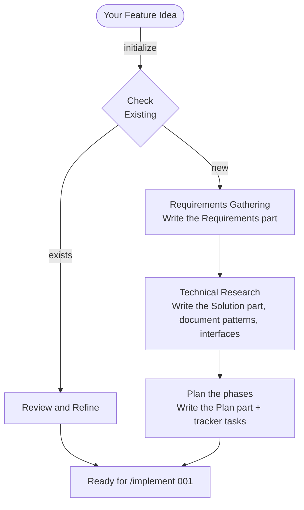
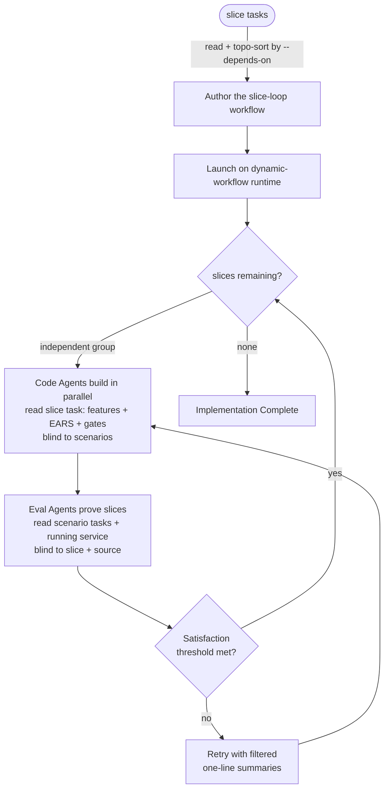
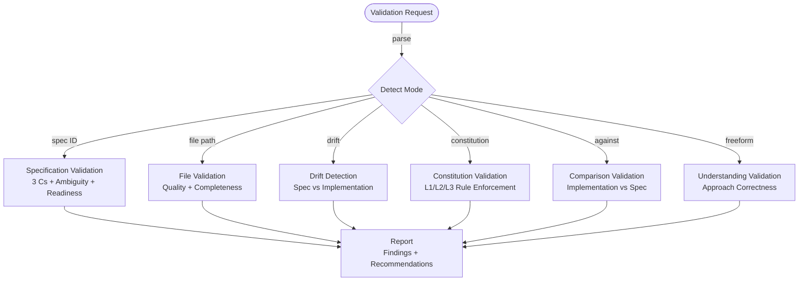
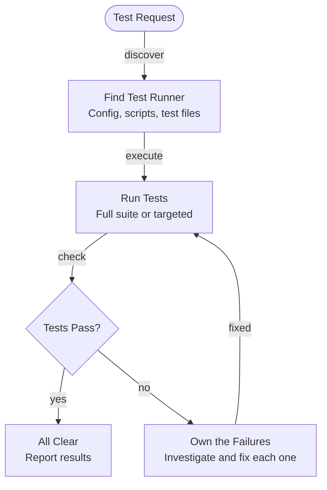
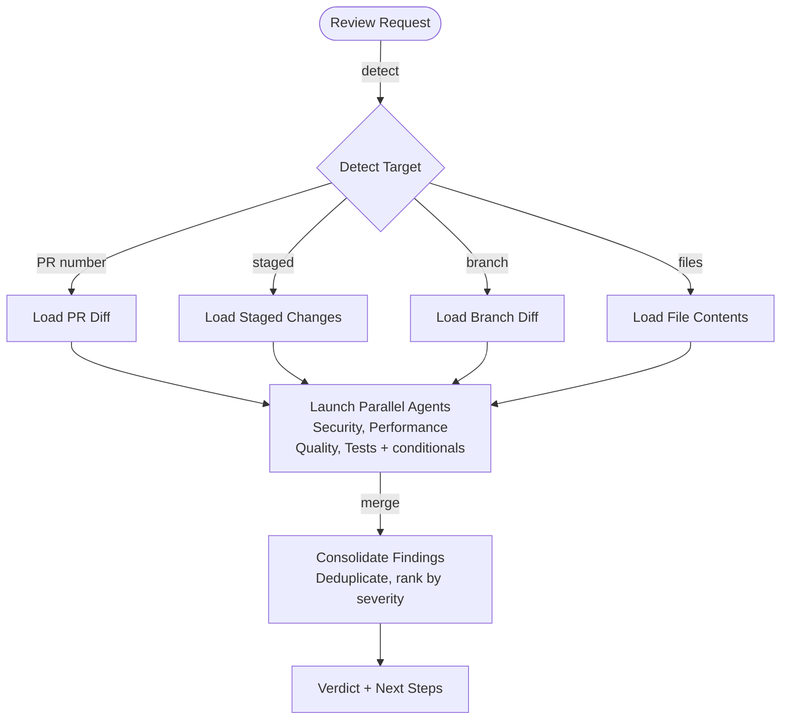

# Start 플러그인 — 에이전트식 스타트업

> 한국어판은 claude-code-mods-ko 프로젝트가 번역했습니다. 원작자와 라이선스는 문서 끝에 있으며, 영어 원문은 [README.en.md](README.en.md)에서 볼 수 있습니다.

**Claude Code에서 명세 중심 개발을 위한 워크플로 오케스트레이션 플러그인.**

`start` 플러그인은 사용자가 호출할 수 있는 워크플로 스킬 열 개, 자율 스킬 다섯 개, 출력 스타일 세 개를 제공해 Claude Code로 소프트웨어를 만드는 방식을 바꿉니다.

**빠른 시작, 워크플로 안내, 스킬 선택은 [메인 README](../../README.md)를 참고하세요.**

## 목차

- [사용자 호출 스킬](#user-invocable-skills) — specify, implement, validate, test, review, document, analyze, refactor, debug, constitution
- [자율 스킬](#autonomous-skills) — 컨텍스트로 활성화되는 5개 스킬
- [문서 구조](#documentation-structure) — specs, domain, patterns, interfaces
- [출력 스타일](#output-styles) — The Garage, The Startup, The ScaleUp
- [일반 개발 워크플로](#typical-development-workflow) — 주 흐름과 유지 보수 흐름
- [실제 스킬 사용](#skills-in-action) — 실제 사례
- [템플릿](#templates) — PRD, SDD, Plan, Scenario
- [철학](#philosophy) — 명세 중심 개발 원칙

## 사용자 호출 스킬

이 스킬은 사용자가 슬래시 명령으로 호출합니다(예: `/specify`). 컨텍스트에 따라 자동 활성화되는 자율 스킬과 달리 명시적 호출을 기다립니다.

### `/specify <description>`

짧은 설명에서 심층 연구와 전문가 에이전트 조율을 통해 포괄적인 명세를 만들고, 서술형 계획과 `/implement`가 실행하는 슬라이스 작업을 산출합니다.

**목적:** 아이디어를 제품 요구 사항, 해결책 설계, 계획을 갖춘 구현 가능한 명세로 바꿉니다. `spec.md` 하나와 트래커의 구현 작업이 결과입니다.

**사용법:**
```bash
/specify Build a real-time notification system with WebSocket support
/specify 001  # Resume existing specification work
```

**주요 기능:**
- **자동 증가 Spec ID** — 001, 002 같은 번호 디렉터리를 자동 생성
- **재개 기능** — ID로 기존 명세 작업을 이어감
- **슬라이스 계획** — 기능(AC), EARS 동작, 품질 관문을 연결하는 자기 완결 슬라이스로 나누고, 보류 시나리오는 별도 시나리오 자식 작업으로 분리
- **의존성 순서** — 슬라이스가 서로 `--depends-on`을 선언하고, 그 그래프가 `/implement`의 병렬화 계약
- **패턴 문서화** — 발견한 패턴을 `docs/patterns/`에 자동 기록
- **인터페이스 문서화** — 외부 서비스 계약을 `docs/interfaces/`에 기록
- **도메인 문서화** — 비즈니스 규칙을 `docs/domain/`에 기록
- **품질 관문** — 주요 단계 사이에 사용자 승인 요구

**각 슬라이스 코드 브리프는 세 가지를 연결합니다:**

| 측면 | 출처 | 역할 |
|-------|--------|------|
| **기능**(인수 기준) | 요구 사항 부분 | 슬라이스가 전달하는 것 |
| **동작**(EARS) | 해결책 부분 | 어떻게 동작해야 하는가 |
| **품질 관문** | 파생 | 확인 가능한 조건 |

**인수 시나리오**는 별도 시나리오 자식 작업(보류 증거)으로, 어떻게 증명되는지를 담습니다.

<details>
<summary><strong>세부 내용 보기</strong></summary>

**결과물:** `.start/specs/[NNN]-[name]/spec.md` 한 문서로, 각 부분이 자체 승인 관문으로 닫히는 세 파트입니다.

- **요구 사항** — 사용자 스토리, 기능 명세, 성공 기준, 비기능 요구 사항
- **해결책** — 기술 아키텍처, 시스템 컴포넌트, 데이터 모델, 기술 스택
- **계획** — 목표 상태와 단계별 결과. 구현 작업(단계 → 슬라이스 → 시나리오 자식 작업)은 **.tracker/**에 있습니다.

Ledger 부분에는 열린 질문, 가정, 결정 로그, 승인된 리뷰 트레이드오프가 있습니다.



</details>

### `/implement <spec-id>`

Claude Code의 다이나믹 워크플로 런타임에서 슬라이스 작업을 실행해 명세를 구현합니다.

**목적:** 검증된 명세를 한 루프로 동작하는 코드로 바꿉니다. 각 슬라이스를 코드 에이전트가 만들고 eval 에이전트가 증명하며, 두 에이전트 사이에 정보 장벽을 두고 만족 임계값까지 재시도합니다.

**사용법:**
```bash
/implement 001
/implement path/to/custom/spec/
```

**동작:**

트래커에서 명세의 슬라이스 작업을 읽고 `--depends-on`으로 위상 정렬한 뒤, 스킬의 루프 계약으로 작성한 다이나믹 워크플로 하나를 실행합니다.

| 단계 | 내용 |
|------|------|
| **읽기** | 슬라이스 작업(`task.js graph`)을 읽음. 각각 기능+EARS+관문 코드 브리프와 보류 시나리오 자식 작업을 가짐 |
| **실행** | 워크플로 스크립트를 작성하고 Workflow 도구로 실행. 독립 슬라이스는 동시에 실행 |
| **루프** | 단계마다 코드 에이전트가 슬라이스를 만듦(의존 체인은 한 에이전트, 병렬 가능하면 슬라이스마다 한 에이전트. 시나리오는 보지 않음) → eval 에이전트가 프로젝트 밖에 둔 보류 스크립트로 단계를 증명(시나리오 작업은 읽고 슬라이스·소스는 보지 않음) → 임계값 또는 최대 반복까지 필터링된 요약으로 재시도 |

**주요 기능:**
- **하나의 루프, 유연한 규모** — 1개 슬라이스는 짧은 루프, 40개는 팬아웃. 선택할 등급·전략 없음
- **구조적 정보 장벽** — 어느 작업을 읽는지가 장벽입니다. 코드 에이전트는 슬라이스 작업, eval 에이전트는 시나리오 자식 작업
- **재개 가능** — 다이나믹 워크플로 런타임이 세션 내 완료 에이전트를 캐시에서 재개
- **드리프트 감지** — `Skill(start:validate)` 드리프트 검사를 실행
- **헌법 강제** — L1/L2 위반은 완료를 막음
- **실시간 갱신** — `/workflows`가 슬라이스별 진행 상황 표시

<details>
<summary><strong>세부 내용 — 슬라이스 루프</strong></summary>

트래커에서 슬라이스 작업을 읽고 `--depends-on`으로 위상 정렬한 뒤, 스킬의 루프 계약으로 작성한 다이나믹 워크플로를 실행합니다. 각 단계는 장벽이 있는 코드→eval 루프를 거칩니다. 코드 에이전트는 슬라이스 작업의 기능+EARS+관문과 AGENTS.md를 읽지만 시나리오 자식 작업은 절대 읽지 않습니다. eval 에이전트는 프로젝트 밖에 보관한 보류 스크립트로 시나리오 작업과 실행 중 서비스(UI 시나리오는 실제 브라우저)를 사용해 단계를 증명하지만 슬라이스·소스는 절대 보지 않습니다. 필터링된 한 줄 실패 요약이 다음 재시도로 흘러가 만족 임계값 또는 최대 반복까지 계속됩니다. 슬라이스가 의존 체인이면 코드 에이전트 하나가 만들고, 병렬 가능하면 각각 에이전트 하나가 동시에 만듭니다.



</details>

### `/validate <target>`

지능형 컨텍스트 감지와 3C 프레임워크(완전성, 일관성, 정확성)로 명세·구현·이해를 검증합니다.

**목적:** 명세 작성 중, 구현 전, 완료 후 등 수명 주기 어느 단계에서도 동작하는 품질 관문.

**사용법:**
```bash
/validate 001                                          # Validate spec by ID
/validate .start/specs/001/spec.md                      # Validate specific file
/validate Check the auth implementation against SDD    # Compare implementation to spec
/validate drift                                        # Check for spec-implementation drift
/validate constitution                                 # Validate constitution compliance
/validate Is my caching approach correct?              # Validate understanding
```

**주요 기능:**
- **지능형 모드 감지** — 입력에서 검증 유형을 자동 결정
- **3C 프레임워크** — 완전성, 일관성, 정확성 검사
- **모호성 감지** — "should", "various", "etc." 같은 모호한 표현 스캔
- **문서 간 추적성** — 요구 사항→해결책→매니페스트 정렬 확인
- **드리프트 감지** — 명세·구현 일치 검사
- **헌법 강제** — L1/L2/L3 거버넌스 규칙 검증
- **자문 전용** — 차단 없이 권고 제공
- **비교 검증** — 구현을 명세와 대조

<details>
<summary><strong>세부 내용 보기</strong></summary>

입력에서 자동 감지되는 **여섯 가지 검증 모드**:

| 입력 유형 | 모드 | 검증 내용 |
|------------|------|---------------------|
| Spec ID(`005`) | 명세 | 전체 명세 품질·준비 상태 |
| 파일 경로(`src/auth.ts`) | 파일 | 개별 파일 품질 |
| `drift` 또는 `check drift` | 드리프트 감지 | 명세·구현 일치 |
| `constitution` | 헌법 | 거버넌스 규칙 준수 |
| "Check X against Y" | 비교 | 구현 대 명세 |
| 자유 형식 텍스트 | 이해 | 접근 방식 정확성 |

**3C 프레임워크:**

1. **완전성(Completeness)** — 모든 섹션 작성, `[NEEDS CLARIFICATION]` 표시 없음, 체크리스트 완료
2. **일관성(Consistency)** — 문서 간 추적성, 용어 정렬, 모순 없음
3. **정확성(Correctness)** — ADR 확인, 의존성 유효, 인수 기준 테스트 가능



</details>

### `/test [target]`

엄격한 코드 소유 원칙으로 테스트를 실행합니다. "원래부터 실패였던 것"이라는 변명은 허용되지 않습니다.

**목적:** 테스트를 찾아 실행하고 코드베이스가 통과 상태로 남도록 하며, 발견된 실패의 소유를 강제합니다.

**사용법:**
```bash
/test                            # Run full test suite
/test all                        # Run full test suite (explicit)
/test src/auth/                  # Run tests for specific path
/test baseline                   # Capture current test state
```

**주요 기능:**
- **테스트 탐색** — 테스트 러너·설정·테스트 파일 자동 발견
- **코드 소유** — 테스트가 실패하면 사용자가 수정 책임을 지며, 기존 문제 탓하지 않음
- **기준 캡처** — 변경 전 통과·실패 상태 기록
- **다중 에이전트 병렬** — 테스트 스위트를 병렬 에이전트에 분산 가능
- **대상 실행** — 특정 파일·디렉터리·전체 스위트 실행

<details>
<summary><strong>세부 내용 보기</strong></summary>

**소유 원칙:** 테스트가 실패하면 "원래 실패였음", "내 변경 때문 아님", "실패를 남겨 둠"이 모두 금지됩니다.

| 입력 | 모드 | 결과 |
|-------|------|--------------|
| 비어 있음 또는 `all` | 전체 스위트 | 모든 테스트 발견 후 실행 |
| 파일/디렉터리 경로 | 대상 지정 | 해당 
| `baseline` | 캡처 | 비교용 현재 테스트 상태 기록 |



</details>

### `/review [target]` — 계속

**사용법:**
```bash
/review                          # Review staged changes
/review 123                      # Review PR number
/review feature/auth             # Review branch changes
/review src/auth/ src/users/     # Review specific files/directories
/review staged                   # Explicitly review staged changes
```

**주요 기능:** 병렬 전문가(보안·성능·품질·테스트), 조건부 관점(동시성·의존성·호환성·접근성), 대상 자동 감지, 발견별 신뢰도(HIGH/MEDIUM/LOW), 심각도(CRITICAL/HIGH/MEDIUM/LOW), 표준·팀 모드.

**항상 활성:** 보안(SQL 인젝션, XSS, 하드코딩 비밀, 인증 우회, 입력 검증), 성능(N+1 쿼리, 누락 인덱스, 메모리 누수, 비효율), 품질(복잡도, 이름, SOLID, 오류 처리, 중복), 테스트(커버리지 공백, 경계 사례, 테스트 품질, 단언 완전성).

**조건부:** 동시성(async/await·Promise·스레딩), 의존성(의존성 파일 변경), 호환성(공개 API·스키마 변경), 접근성(프론트엔드 컴포넌트 변경), 헌법(CONSTITUTION.md 존재).



</details>

### `/document [target]`

문서를 만들고 갱신하며, 코드 변경에서 문서를 자동 생성합니다.

**목적:** 코드베이스의 변경을 추적해 문서를 최신 상태로 유지하고, 중복을 제거하며, 사용자·개발자·운영자 문서를 동기화합니다.

**사용법:**
```bash
/document                        # Document recent changes
/document src/auth/              # Document specific area
/document api                    # Update API documentation
```

**주요 기능:** 변경 감지 기반 문서화, 자동 문서 생성, 중복 제거, 교차 참조 유지, 문서 품질 검증.

### `/analyze <area>`

코드베이스의 특정 영역을 심층 분석해 아키텍처, 의존성, 잠재 위험을 파악합니다.

**목적:** 변경 전에 구조를 이해하고 영향 범위를 파악합니다.

**사용법:**
```bash
/analyze authentication
/analyze src/api/
```

**주요 기능:** 아키텍처 매핑, 의존성 그래프, 복잡도 분석, 위험 영역 식별, 권고사항 제시.

### `/refactor <description>`

동작을 바꾸지 않고 코드 구조를 개선합니다.

**목적:** 품질·가독성·유지 보수성을 높이면서 기존 기능과 테스트를 보존합니다.

**사용법:**
```bash
/refactor Simplify the auth middleware
/refactor Extract payment logic into a service
```

**주요 기능:** 안전한 단계별 리팩터링, 테스트 기반 검증, 동작 보존 확인, 패턴 적용.

### `/debug <description>`

체계적인 조사를 통해 버그의 원인을 찾고 수정합니다.

**목적:** 추측하지 않고 증거를 바탕으로 근본 원인을 해결합니다.

**사용법:**
```bash
/debug Login fails with 401 after token refresh
/debug Memory leak in worker process
```

**주요 기능:** 재현, 가정 검증, 로그·상태 분석, 근본 원인 확인, 회귀 테스트 추가.

### `/constitution [focus-areas]`

프로젝트의 거버넌스 규칙(`CONSTITUTION.md`)을 만들고 갱신합니다.

**목적:** L1(불변 원칙), L2(규칙), L3(관례) 수준의 프로젝트 헌법을 정의해 에이전트 행동을 일관되게 제약합니다.

**사용법:**
```bash
/constitution
/constitution security performance
```

**주요 기능:** 원칙 정의, 규칙 계층화, 위반 감지 기준 제시, 다른 스킬의 강제 규칙으로 사용.

### 보안: 하드코딩 비밀 금지

모든 스킬은 비밀 값(API 키, 토큰, 비밀번호)을 코드·명세·문서에 하드코딩하지 않습니다. 환경 변수와 보안 저장소를 사용하고, 커밋 전에 비밀을 스캔합니다.

### 설치

메인 README의 설치 안내를 따르세요. 이 플러그인은 Claude Code 플러그인 마켓플레이스로 배포됩니다.

## 자율 스킬

자율 스킬은 컨텍스트에 따라 자동 활성화됩니다. 사용자가 명시적으로 호출할 필요가 없습니다.

### 명세 스킬

요구 사항·해결책·계획 작성 시 컨텍스트에 맞춰 활성화되어 명세 품질과 추적성을 돕습니다.

### 구현 스킬

코드 작성·수정 중 활성화되어 패턴 준수, 품질 관문, 헌법 규칙을 적용합니다.

## 문서 구조

- `specs/` — 번호가 붙은 명세 디렉터리(`spec.md`)
- `domain/` — 비즈니스 규칙과 도메인 지식
- `patterns/` — 재사용 가능한 설계 패턴
- `interfaces/` — 외부 서비스 계약

### 자동 문서화

코드와 명세의 변경을 감지해 관련 문서를 자동 갱신합니다.

### 중복 제거

같은 정보가 여러 문서에 흩어지지 않도록 단일 출처를 유지하고 중복을 제거합니다.

## 출력 스타일

- **The Garage** — 실험적이고 빠른 프로토타입 작업에 적합한 간결한 스타일
- **The Startup** — 제품 개발에 맞춘 균형 잡힌 스타일
- **The ScaleUp** — 확장 단계의 엄격한 검증과 거버넌스 중심 스타일

### 스타일 활성화

Claude Code의 출력 스타일 설정에서 원하는 스타일을 선택합니다.

## 일반 개발 워크플로

### 설정(선택)

프로젝트에 `CONSTITUTION.md`를 두고, 저장소 구조와 테스트 러너를 확인합니다.

### 주 워크플로: Specify > Validate > Implement > Review

1. `/specify`로 명세와 슬라이스 작업을 만듭니다.
2. `/validate`로 명세를 검증합니다.
3. `/implement`로 슬라이스를 구현하고 eval 에이전트가 증명합니다.
4. `/review`로 병합 전 변경을 검토합니다.
5. `/test`로 전체 테스트를 통과 상태로 유지합니다.
6. `/document`로 문서를 갱신합니다.

### 유지 보수 워크플로

`/analyze`, `/debug`, `/refactor`, `/constitution`을 필요할 때 사용하고, 변경 후에는 `/validate`, `/test`, `/review`를 다시 실행합니다.

## 실제 스킬 사용

### 예: Document 스킬로 지식 캡처하기

회의나 대화에서 결정된 내용을 `/document`로 프로젝트 문서에 기록하고, 이후 `/analyze`로 관련 코드와 연결합니다. 새 결정은 기존 문서를 갱신하며 중복은 제거됩니다.

## 템플릿

- **PRD** — 제품 요구 사항 문서
- **SDD** — 소프트웨어 설계 문서
- **Plan** — 구현 단계와 결과
- **Scenario** — 보류 인수 시나리오

## 철학

### 명세 중심 개발

구현 전에 요구 사항·설계·계획을 명확히 하고, 그 명세를 기준으로 코드를 작성하고 증명합니다.

### 핵심 원칙

- 명시적인 요구 사항과 추적 가능한 결정
- 정보 장벽을 통한 독립적 검증
- 테스트 실패에 대한 책임 소유
- 단일 출처 문서와 자동 동기화
- 헌법 규칙에 따른 일관된 에이전트 행동

## 더 읽을거리

- [메인 README](../../README.md)
- [Claude Code 문서](https://code.claude.com/docs/ko)

## 한국어 마켓플레이스 설치

```
/plugin install start@claude-code-mods-ko
```

## 출처 및 라이선스

- 원작자: [rsmdt](https://github.com/rsmdt/the-startup)
- 원본 저장소: https://github.com/rsmdt/the-startup
- 라이선스: MIT
- 한국어 번역 및 UI 현지화: claude-code-mods-ko 프로젝트
