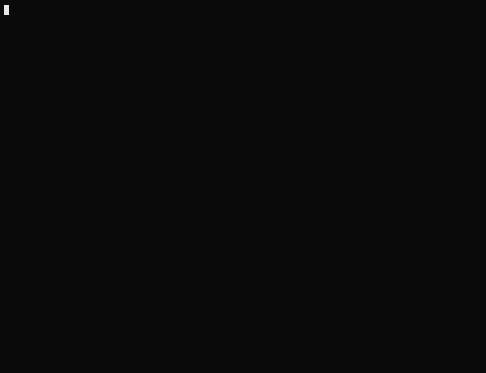
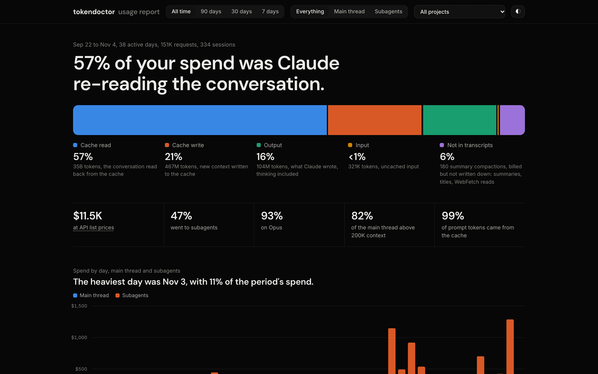

<p align="center">
  <picture>
    <source media="(prefers-color-scheme: dark)" srcset="docs/logo.svg">
    
  </picture>
</p>

<h1 align="center">tokendoctor</h1>

> 한국어판은 claude-code-mods-ko 프로젝트가 번역했습니다. 원작자와 라이선스는 문서 끝에 있으며, 영어 원문은 [README.en.md](README.en.md)에서 볼 수 있습니다.

<p align="center">
  <strong>같은 Claude Code를 최대 38% 저렴하게</strong>
  <br>
  여러분의 지난 세션을 다시 재생해 각 변경이 얼마를 절약했을지 보여 준 뒤, 선택한 것만 변경합니다.
</p>

<p align="center">
  <a href="https://github.com/localixai/tokendoctor/actions/workflows/ci.yml"></a>
  <a href="CHANGELOG.md"></a>
  <a href="LICENSE"></a>
</p>

<p align="center">
  <a href="#install">설치</a> &bull;
  <a href="https://tokendoctor.localix.ai/docs">문서</a> &bull;
  <a href="https://tokendoctor.localix.ai">웹사이트</a> &bull;
  <a href="CHANGELOG.md">변경 내역</a>
</p>

<p align="center">
  
</p>

**여러분의 지난 세션이 판단합니다. 남의 벤치마크가 아닙니다.** 설정이 절약하는 금액은 작업 방식에 따라 달라집니다. 세션이 얼마나 오래 지속되는지, 어떤 모델을 쓰는지, 어떤 작업을 하는지에 달려 있습니다. 다른 사람(저 포함)의 세션에서 나온 숫자는 여러분의 세션을 잘 말해 주지 못합니다. 그래서 tokendoctor는 먼저 여러분 자신의 기록을 되돌아봅니다.

**① 최근 30일을 돌아봅니다.** `/tokendoctor:sessions`는 여러분의 모든 세션을 요청 단위로 재생하며, 200K, 300K, 400K, 600K 압축 창에서 각각 얼마가 들었을지 보여 줍니다. 트랜스크립트만 읽고, 모델 호출도 없으며, 아무것도 변경하지 않습니다. 수치는 상한선입니다. 재생은 요약 이후 모델이 다시 했을 작업을 볼 수 없기 때문입니다.

**② 세션이 이득이라고 보여 준 것만 바꾸고, 되돌립니다.** `/tokendoctor:optimize`는 그 수치를 바탕으로 변경안을 제시하고 Claude Code 문서와 설정을 대조합니다. 여러분이 고른 것만 적용하며 각각 먼저 diff로 보여 줍니다. `/tokendoctor undo`는 그중 무엇이든 되돌립니다.

**③ 선택 사항: 요약 대신 밀어내기.** Claude Code가 대화를 요약하려 할 때 tokendoctor는 오래된 도구 출력을 버리고 모든 메시지를 유지합니다. 모델 호출이 없으므로 1분이 아니라 밀리초가 걸립니다.

## 설치

```bash
claude plugin marketplace add localixai/tokendoctor
claude plugin install tokendoctor@tokendoctor
```

Claude Code를 재시작하고 `/tokendoctor:sessions`를 실행해 최근 30일이 각 창에서 얼마였을지 확인하세요. 선택하기 전에는 아무것도 바뀌지 않습니다.

## 제 세션에서 발견한 것

모든 요청은 전체 대화를 모델에 보냅니다. 1M 윈도우 모델에서 Claude Code는 약 967K 토큰 근처에서만 압축하므로, 긴 세션의 끝부분이 비싼 부분입니다. 제 경우 메인 스레드 비용의 3분의 2가 컨텍스트 400K를 넘는 요청에 들었습니다.

그래서 400K 창과 서브에이전트용 Sonnet을 설정했습니다. 전달 월과 다음 주를 비교하면 메인 스레드 요청이 약 23K와 19K였고, 요청당 컨텍스트는 412K에서 219K로, 요청당 비용은 API 정가 기준 38% 감소했습니다. 이는 한 사람의 전후 비교이며 통제된 실험이 아닙니다.

단점은 요약이 늘어난다는 점이고, 요약마다 멈춤이 발생합니다. 제 세션에서는 평균 79초였습니다. 밀어내기 기능은 그걸 위한 것입니다. 여러분의 세션은 전혀 다른 결과를 보일 수 있으며, 그래서 먼저 살펴보는 것이 핵심입니다.

## 벤치마크가 보여 주는 것

[벤치마크](bench/README.md)에서 Claude Code는 수정할 수 없는 테스트에 대해 TypeScript 프로젝트를 만들며, 테스트가 통과해야만 실행이 성공으로 셉니다. 비용은 Haiku 5.5에서 작업당 기준입니다.

| 비교 항목 | 비용 | 시간 |
| --- | --- | --- |
| 밀어내기 대 요약, 하루치 작업 | −19% | −33% |
| 밀어내기 대 요약, eval 하네스 | −35% | −28% |
| 밀어내기 대 요약, 짧은 작업 | +6% | −17% |
| 설정 조언만, 기본 Claude Code 대비 | 4회 중 3회에서 더 비쌈 | |
| 조언과 밀어내기, 일주일치 작업 | −11% ~ −21% | |

모든 실행에서 모든 테스트가 통과했습니다. 설정 조언만으로는 여기서 이득이 없었는데, 이 작업들은 400K를 거의 넘지 않아 창 설정이 효과를 발휘하지 못했기 때문입니다. 여러분의 세션도 그렇다면 재생 결과가 그것을 보여 줄 것이므로 창을 건드리지 말아야 합니다. 지는 실행까지 포함해 모든 실행이 [bench/HISTORY.md](bench/HISTORY.md)에 있습니다.

<p align="center">
  <br>
  <sub><code>/tokendoctor:dashboard</code>: 모든 토큰이 어디로 갔는지 일자, 모델, 서브에이전트, 프로젝트별로 보여 줍니다. 로컬 파일 하나이며 이 것은 제 것입니다.</sub>
</p>

## 명령

| 명령 | 동작 |
| --- | --- |
| `/tokendoctor:sessions [days]` | 지난 세션을 더 작은 창(30일 또는 `days`)에서 재생합니다. 각 경우 얼마를 절약했을지, 토큰이 어디에 쓰였는지 보여 줍니다. 읽기 전용. |
| `/tokendoctor:audit` | 설정, 메모리, CLAUDE.md를 문서와 대조해 심각도별로 확인합니다. 읽기 전용. |
| `/tokendoctor:dashboard [days]` | 이 컴퓨터의 모든 세션에 대한 로컬 대시보드를 엽니다. |
| `/tokendoctor:optimize [focus]` | 수치를 바탕으로 최대 다섯 가지 변경안을 제시하고 선택한 것을 적용합니다. |
| `/tokendoctor [name] [value]` | 모델 호출 없이 설정을 보여 주거나 설명하거나 변경합니다. |
| `/tokendoctor undo [n]` | tokendoctor가 만든 모든 변경을 나열하고 하나를 되돌립니다. |

컴퓨터 밖으로 나가는 것은 없습니다. 유일한 네트워크 호출은 하루 한 번 Claude Code 문서의 공개 페이지 두 곳에 대한 것입니다. 모델을 혼자서 바꾸지 않습니다.

## 문서

**[tokendoctor.localix.ai/docs](https://tokendoctor.localix.ai/docs)**에 나머지가 있습니다: [38가지 검사](https://tokendoctor.localix.ai/docs/audit), 모든 [설정](https://tokendoctor.localix.ai/docs/settings), [밀어내기 동작 방식](https://tokendoctor.localix.ai/docs/slide)(그리고 Team/Enterprise 로그인), 셸에서의 명령, [측정 결과](https://tokendoctor.localix.ai/docs/proof), [한계](https://tokendoctor.localix.ai/docs/limits). tokendoctor 자체를 개발하려면 [CONTRIBUTING.md](CONTRIBUTING.md)를 참고하세요.

## 라이선스

MIT

## 설치 (한국어 마켓플레이스)

```
/plugin install tokendoctor@claude-code-mods-ko
```

## 출처 및 라이선스

- 원작자: [localixai](https://github.com/localixai/tokendoctor)
- 원본 저장소: https://github.com/localixai/tokendoctor
- 라이선스: MIT
- 한국어 번역 및 UI 현지화: claude-code-mods-ko 프로젝트
